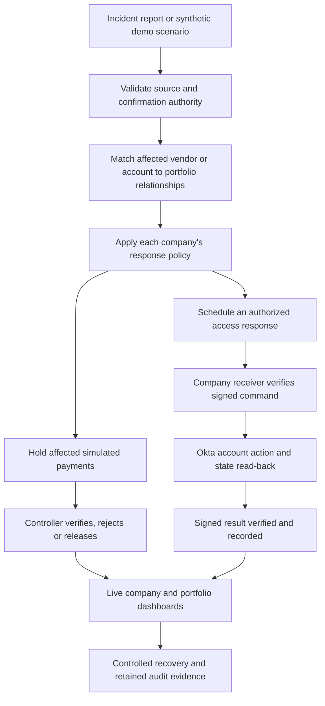

# Sidecall

**One vendor incident. A coordinated response across the portfolio.**

Sidecall coordinates company-approved responses to shared-vendor incidents across a private equity portfolio, with verified actions and controlled financial recovery.

[Open the demo](https://sidecall.vercel.app/) · [Architecture](#how-we-built-it) · [Real vs. simulated](#what-is-real-and-what-is-simulated) · [Run locally](#run-locally)

Built at **Cal Hacks 13.0**. This is a working hackathon prototype: the portfolio and payment ledger are simulated; the configured Okta integration acts on a real, disposable test account.

## The problem

A private equity firm owns several independently operated companies. Those companies may share payroll providers, IT contractors, vendor accounts or administrative credentials without having a shared incident-response process.

When one company reports a compromise, the firm needs answers quickly:

- Which sister companies actually share the affected vendor or login?
- Which pending payments or accounts need protection?
- Who is allowed to act, and did the action really happen?
- How can the unaffected business keep running—and the affected business recover safely?

An email warning leaves each company to connect the dots. Freezing everything creates another business disruption. Sidecall connects the incident to the specific relationships, payments and pre-approved actions that matter.

## The idea and value proposition

**Give headquarters a shared view while keeping financial and security authority with each company.**

Sidecall fills the coordination gap between an incident report and a completed response. It identifies exposure, applies the company's existing policy, tracks verified outcomes and preserves the decisions needed to recover.

| Who uses it | What they get |
| --- | --- |
| Portfolio operations / PE firm | A live map of exposure, payment outcomes, acknowledgments and outstanding response work across companies. |
| Accounts payable clerk | An explanation of why a bill is held and a controlled route to request a corrected payment. |
| Company controller | Verification evidence, independent approval and a record of why a payment was released or rejected. |
| Company IT lead | Targeted response steps, authenticated execution receipts and a separate restoration process. |

The intended value is less manual coordination, earlier targeted containment and a safer way to continue paying legitimate bills. We demonstrate those workflows; we have **not** measured customer ROI or prevented a real $480,000 loss.

## How the workflow works



1. **Receive and assess the report.** Unconfirmed reports can warn linked companies, but disruptive actions require confirmation or an explicitly authorized detector. Built-in practice scenarios supply synthetic confirmed incidents.
2. **Find the relevant exposure.** A shared login, shared administrative access and merely using the same vendor are different relationships. A company with separate credentials is not treated as sharing a leaked login. Public DNS findings remain candidate relationships, not proof of shared access.
3. **Apply company-approved controls.** Depending on the policy, a response is notify-only, requires a click, or is pre-approved. Applicable pending payments are held in the simulated ledger; recent bank-detail changes are flagged for review.
4. **Verify the result.** Payment decisions are enforced on the backend. External account actions require a matching authenticated receipt; sending a request is not enough to show success.
5. **Recover without losing the record.** A rejected payment remains rejected. A corrected replacement goes through its own request and approval. Account restoration has separate controls, and the firm can see what still needs attention.

**Acknowledged, payment resolved and incident contained are different states.** A company acknowledging an alert means someone has seen it. Rejecting a payment does not fix the compromised vendor or close the security incident.

## The demo: two connected business problems

### 1. Stop a suspicious payment, then pay the legitimate bill

Brightline Payroll has a reported incident. Summit Home Health has a **simulated $480,000 payment** going to account ending **7731**, changed by email two days before the incident. The previous phone-confirmed destination ends in **2208**.

1. Sidecall holds the payment and highlights the changed destination.
2. **Jamie Chen**, the requester, cannot approve their own payment.
3. **Rosa Alvarez**, the controller, records a practice callback to the number already on file and rejects the incorrect payment.
4. Under **Recover this bill**, Rosa verifies the corrected destination, **2208**, and prepares a bill-specific correction.
5. Jamie requests that replacement; Rosa independently verifies and releases it.
6. **Jordan Ames**, at the PE firm, sees both outcomes: **$480,000 rejected—not paid**, and **$480,000 released after verification**. Other unresolved payments remain held.

These are two records for one bill: the rejected attempt and its replacement. They are not two successful payments. The callback is a human attestation; Sidecall does not place or independently authenticate the phone call.

### 2. Act on a shared login before an email is read

The **Ironclad shared-login** scenario affects Cedar Ridge Manufacturing's configured shared account.

1. A confirmed incident activates the company's pre-approved pause policy.
2. Convex persists the command and schedules delivery to a separate company-controlled receiver.
3. The receiver checks the signature, freshness, command identity, target allowlist and local limits.
4. For the configured disposable account, it asks **Okta to suspend the user**, reads the resulting state and returns a signed receipt.
5. **Sam Kowalski**, Cedar Ridge's IT lead, sees the confirmed result in Sidecall. The presenter can independently show **Suspended** in the actual Okta Admin Console.
6. Authorized restoration returns the eligible account to **Active**, with the action history retained.

**Okta suspends an account, not a payment.** Financial holds happen separately in Sidecall's simulated ledger. A suspension blocks new sign-ins while suspended; an acknowledged session-revocation request does not prove every downstream application session ended.

## Automation with boundaries

- **Limited authority:** companies choose the response policy; the firm cannot release a company's held payment.
- **Independent approval:** the requester cannot release their own held payment, even through a direct backend call.
- **Replay protection:** duplicate reports and commands retain their identities instead of repeating effects.
- **Protection against repeated disruption:** response-episode controls and a receiver pause budget limit repeated automatic actions. The demo receiver defaults to three new pauses per rolling hour; a fresh rehearsal still counts.
- **Honest failure states:** pending, refused and unknown are displayed separately from confirmed. Lost replies are reconciled using the original command identity.
- **Controlled restoration:** ordinary account recovery requires company-local operator approval. One incident cannot release another incident's hold, and pre-existing suspensions are not automatically undone.
- **Scoped visibility:** company views exclude the reporting company's identity; the PE view coordinates the portfolio. The demo role picker is a presentation convenience, not production identity assurance.

## Where AI fits

Claude helps turn incident and payment evidence into useful explanations, verification packets and vendor communications. The core demo includes AI-written text generated ahead of time so a live model call is not required for each alert.

The repository also contains a bounded invoice-to-payment assistant workflow: it reads synthetic documents and uses company-scoped tools against saved bills. Separately approved routine-purchase authority can permit settlement within its limits; exceptions and incident-related holds return to human review. The model cannot grant itself authority, rewrite a payee or release a held payment.

Exposure rules, authorization checks, payment controls and receiver execution do not depend on accepting an AI answer as permission. [Recorded assistant proof](scripts/assistant/README.md) describes the real model calls, synthetic inputs and exact limits of that test.

## How we built it

| Layer | Implementation and responsibility |
| --- | --- |
| UI | React, TypeScript, Vite and Tailwind; company-specific views and a portfolio relationship graph. |
| Shared backend | Convex database, authenticated queries, transactional mutations, HTTP intake and scheduled jobs. Live subscriptions update both sides of the workflow. |
| Identity and permissions | Convex Auth plus server-side company and role checks. Seeded demo identities use a shared demo password. |
| Financial controls | Held-payment state, verification evidence, replacement requests, decision history and a simulated double-entry ledger. |
| AI and tools | Anthropic Claude for writing/extraction and scoped assistant workflows; MCP tools enforce backend authority. |
| External response | Separate Node.js receiver with durable SQLite command history, HMAC-SHA256 commands/receipts and an Okta adapter. Provider credentials stay at the receiver. |
| Hosting | Vercel frontend and Convex backend. The hackathon receiver is a separately running service reached through an HTTPS tunnel. |

Convex commits the applicable database changes atomically, then scheduled jobs perform external work. **An Okta API call is not part of a Convex database transaction.** Persisted command identities, reconciliation and verified receipts bridge that boundary.

Useful code entry points: [incident intake](convex/http.ts), [incident processing](convex/incidents.ts), [payment controls](convex/payments.ts), [role checks](convex/access.ts), [receiver orchestration](convex/responseReceiver.ts), [company receiver](integrations/company-receiver/receiver.mjs) and [portfolio UI](src/panels/PortfolioView.tsx).

## What is real and what is simulated

| Capability | What the MVP demonstrates |
| --- | --- |
| Portfolio, people and incident reports | Fictional companies and seeded users; synthetic incidents, not detection of a live attack. |
| Shared backend and UI synchronization | Real Convex queries, mutations, scheduled execution and live updates across signed-in clients. |
| Payments | Simulated bills, balances, bank changes and ledger entries. No bank transfer, card charge or Visa network transaction. |
| Phone verification | An operator records a callback assertion; demo calls are role-played. |
| Okta pause and restoration | Real provider actions on the specifically configured disposable test account when the receiver is available and permits them. Other response steps retain their simulated/sandbox labels. |
| Execution evidence | Authenticated command results and provider state read-back at a recorded time; not a guarantee the account can never change afterward. |
| AI | Pre-generated writing plus separately tested live assistant workflows. Not every page load or alert makes a live model call. |
| Notifications | Recorded as simulated by default; live delivery requires separate configuration. |
| Tests and scorecard | Authored regression tests and planted cases, not a real-world detection-accuracy benchmark or production security certification. |

## Sponsor alignment

Our clearest demonstration is the combination of **Convex**, **Hyphenate's autonomous finance workflow**, and **Armadin's security track**.

| Track | What we demonstrate |
| --- | --- |
| **Convex — Best use of Convex** | A shared operational workflow: transactional policy decisions, role-scoped data, durable scheduled delivery/reconciliation, and dashboards that reflect the same changing state. |
| **Hyphenate — Autonomous Systems for Finance** | An AP exception coordinator that initiates holds and escalations, prepares evidence, respects separation of duties and supports financial recovery. Automation works within company policy; a controller retains authority over exceptions. |
| **Armadin — Best Security Hack** | Targeted cross-company incident response, authenticated commands, restricted execution, replay resistance and real test-account suspension with verified results. This is not a claim of an Armadin API integration or a real intrusion detected by Sidecall. |

**Visa / AI commerce:** bounded purchasing and payment trust are related ideas, but this demo focuses on B2B incident response and AP recovery. It does not process Visa payments or demonstrate a complete AI shopping journey. We do not present the Okta integration as payment-network functionality.

## What we learned and what comes next

The hard part was deciding **when to act, how narrowly to act and what counts as proof**. Sharing a vendor is not the same as sharing a credential. A request sent is not an action verified. Rejecting a suspicious payment is not the end of paying the bill.

The MVP demonstrates that complete loop with an auditable handoff between automation and people. Before a real pilot, the next work is durable receiver hosting, production identity and credential management, maintained vendor/account relationships, real AP integrations, and customer validation of the response policies and operating value. Shared demo controls and temporary hosting are not a production deployment model.

## Try the workflow

Open [sidecall.vercel.app](https://sidecall.vercel.app/) and choose a seeded person from **Sign in as**. The shared demo password, if requested, is `sidecall-demo`.

| Seat | Page to show |
| --- | --- |
| Jordan Ames — Northpass Capital | **Map & evidence** for the portfolio; **Payments & controls log** for payment history. |
| Jamie Chen — Summit Home Health | The held payment and the corrected replacement request. |
| Rosa Alvarez — Summit Home Health | Verification, rejection, **Recover this bill**, then independent replacement release. |
| Sam Kowalski — Cedar Ridge Manufacturing | **Incident & evidence**, including the automatic pause receipt. |

Use **Simulator** to choose **Brightline payroll breach** or **Ironclad shared login leaked**, then **Fire incident**. The incident selector on the portfolio page chooses which already-recorded incident to inspect; the simulator selector chooses what to trigger next.

For two computers, use the same public URL and different demo seats. Localhost may use a separate development database and will not necessarily show the public site's state. Coordinate with the presenters: the public demo is shared, and a reset affects the other viewers.

**Practice Reset:** on the configured connected demo, Reset first attempts to restore and verify the eligible disposable Okta account paused by the demo, then clears simulated payments and unfinished AI tests. External command/recovery history stays available. It stops on unresolved recovery rather than silently claiming success, does not recreate revoked sessions, and does not reset the receiver's hourly budget. Refreshing the browser is not a reset.

The real Okta demonstration depends on the receiver, its persistent storage, HTTPS route and test tenant being available. A refused or unknown result is not a confirmed suspension. Do not use these practice controls with customer accounts or real financial data.

## Run locally

Use Node.js 24 if running the SQLite-based receiver. For the application, install dependencies and configure a development deployment:

```sh
npm install
npx convex dev
```

On first use, sign in and select the existing Sidecall project and your own development deployment. Team members need a Convex project invite. Let initialization finish, then stop that process before using the combined command below. A fresh independent project also needs Convex Auth configuration; the repository already contains the auth integration, but does not include private signing keys.

On a **disposable development dataset only**, enable the practice controls and seed the portfolio:

```sh
npx convex env set DEMO_MODE true
npx convex run seed:run
npm run dev
```

`npm run dev` starts Convex and Vite together. Use the URL Vite prints. Seeding/resetting is not a migration for existing customer data.

The base demo does not require an Anthropic key or an Okta token. Live AI and external account actions need separate private configuration. Never put provider tokens in a `VITE_*` variable or commit environment files.

### Checks and evidence

```sh
npm test
npm run test:receiver
npm run build
npm run lint
```

The October 25 final review passed **300 application tests and 29 receiver tests**. These exercise authorization, payments, replay, recovery and failure handling; they are not a claim of exhaustive security coverage. Routine receiver tests use provider substitutes, separate from the live test-account rehearsals.

- [Real Okta rehearsal evidence](docs/evidence/full-rehearsal-okta.json): recorded DEV suspension, unaffected control account and restoration checks.
- [Real assistant rehearsal](scripts/assistant/README.md): scope and redacted model/tool evidence.
- [Receiver protocol and configuration](integrations/company-receiver/README.md): signatures, local controls and provider boundaries.
- [Reset and receiver operating notes](docs/receiver-dev-runbook.md): recovery behavior and rehearsal limits.

Some linked runbooks and Devpost drafts retain dated checkpoint statements such as “DEV only” or older reset behavior. They describe those runs, not a fresh availability check of the public demo. This README summarizes the final hackathon workflow; recorded evidence keeps its original environment and limitations.

### Deployment

The existing [Vercel configuration](vercel.json) deploys from `main` and runs:

```sh
npx convex deploy --cmd 'npm run build'
```

Configure `CONVEX_DEPLOY_KEY` privately in Vercel's Production environment; Convex supplies `VITE_CONVEX_URL` during the build. A production-labelled hackathon dataset is still a demo dataset. Enable `DEMO_MODE` and seed only when that destructive practice behavior is intended.

The company receiver is deployed separately and needs persistent SQLite storage and a stable HTTPS route for reliable operation. It is not hosted by the Vercel frontend, and the temporary hackathon tunnel does not make it an always-available service.
