# 1 Start here

Sidecall is a working demonstration of controlled automation for a group of companies that share vendors. Its job is to connect a credible incident to the companies and payments it affects, apply only the actions those companies authorized, and keep unrelated business moving. It also lets an AI request a narrowly approved purchase while the server retains control over identity, destination, amount and budget.

The simplest complete story is this: a payroll vendor has a problem; Sidecall identifies the companies that depend on it; relevant payments wait for independent verification; a different, safe office-supplies purchase can still complete; every decision leaves evidence. The system combines incident response and accounts payable around the same company, vendor, permission and payment records.

## What this guide is for

Every teammate should be able to trace an action from the screen to the server, explain who is allowed to do it, identify the record proving the outcome, and name the limits. Start with chapters 1 and 2 together. Study chapters 3 through 10 in pairs, then swap explanations. Use the screen walkthrough and rehearsal before making submission claims. The final chapters provide track wording, troubleshooting and a code map.

This is a functional guide to the implementation and its controls. The linked source code supplies line-level detail. The product snapshot is branch **feat/pegasus-purchase-console**, commit **d6d6f82**, on October 24, 2026. The checked main commit is **0ea25c2**. Repository and production state can change after this snapshot; the release checklist explains how to reconcile them.

## What is actually available

| Layer | Status at this snapshot | What the team may say |
|---|---|---|
| Main branch | Incident intake, graph, scoped response, ledger, purchasing controls, verified release and recovery are present | These capabilities exist in the reviewed main source; the selected live environment must still be rehearsed |
| PR 132 | Open, not merged at the status check; adds the visible one-shot Claude purchasing console and control challenges | Built and exercised on Pegasus DEV; do not say it is on the public website until deployment is verified |
| Pegasus DEV | tangible-koala-842; saved live reports show the console working with the server key | A particular DEV run passed; that is evidence, not a permanent health guarantee |
| Public website | sidecall.vercel.app was opened at its private-demo password screen | Reaching the password screen does not verify the app, backend, key or new console |
| Advice proposals | PR 114 held; 119 and 123 readiness/advice are not mounted by this candidate | Do not point judges to an absent screen or call those proposals shipped |
| Teammates’ chatbot | Separate ownership; no mounted chatbot was found in this inspected source | Its owner must demonstrate it separately; the purchasing console is not proof that it works |

**A source branch, a deployed backend and an open browser are three different things.** A new frontend can call functions missing from an old backend. A valid API key on one DEV does not configure production. A stale browser can show an old deployment. This explains many apparent contradictions without proving that any particular screen is broken.

## Real software and simulated business

Real behavior includes sign-in and role checks, stored records, live query updates, atomic database changes, bounded model calls, duplicate protection, audit entries and the configured owned sandbox’s access control. Synthetic elements include the companies, people, invoices, account suffixes, incidents and money. The ledger is an accounting simulation: no bank or Visa network transfers money.

An identity-provider action is simulated unless the UI explicitly reports an effect on Sidecall’s own provisioned sandbox resource. That sandbox is real access enforcement on a resource the team owns; it is not an integration with a customer’s Microsoft, Okta or Google tenant. A recorded callback means a person asserted that they called the saved vendor number; software does not prove that the call occurred.

## The six ideas everyone must understand

1. **A report is a claim.** Authentication identifies and limits its source; it does not prove that a breach happened.
2. **The graph supplies scope.** It connects companies to specific shared vendors or accounts. Being connected does not prove compromise.
3. **Policy supplies authority.** Company settings and current roles determine what can happen automatically.
4. **The server decides money outcomes.** Claude can ask; it cannot approve itself or bypass a hold.
5. **Stored evidence proves an outcome.** Inspect a payment, receipt and ledger entry rather than relying on model prose or an animation.
6. **A safe workflow must preserve continuity.** A suspicious vendor should not stop every unrelated purchase or repeatedly restart the same response.

Sources: [repository snapshot](https://github.com/Adriancluna/sidecall/tree/d6d6f82779edeaa43c7e8ba599f7a2ce133fd604), [PR 132](https://github.com/Adriancluna/sidecall/pull/132), [merged recovery PR 130](https://github.com/Adriancluna/sidecall/pull/130).

# 2 The problem and the people

A private-equity firm owns or invests in several businesses. Those businesses form its **portfolio**. Each company may depend on the same payroll vendor, software provider, managed IT service or shared login. If one company notices a problem, sister companies need to know whether they share the same exposure. At the same time, their finance teams must distinguish a genuine payment problem from unrelated work that should continue.

**Accounts payable**, shortened to AP, is the work of recording supplier bills and arranging payment. A **bill** says what is owed. A **payment** is an attempt to settle that bill. A **controller** is the finance person authorized to verify and approve certain decisions. A **ledger** is the accounting record. A **mandate**, called a purchasing approval in the UI, is a stored instruction that permits a limited class of future requests.

## Four seats with different powers

| Seat | Can do | Cannot do |
|---|---|---|
| AP clerk | View own-company finance records, request payment, submit an approved bill to Claude, consume a prepared correction | Approve their own purchase, release or reject held money, create controller authority |
| Controller | Set purchasing approvals, manage payment-hold policy, verify or reject held money, prepare corrections | Release a payment they requested; silently alter facts being signed; act as another company |
| Company IT | Read own incident evidence, acknowledge, manage eligible response policy and steps | Release payments or inspect another company’s private incident record |
| PE firm operator | Coordinate the portfolio, review reports, inspect portfolio evidence, onboard companies, contain incidents | Release a subsidiary’s payment or adopt that company’s response policy for it |

In the seeded story, **Jamie Chen** is Summit’s AP clerk, **Rosa Alvarez** is its controller, **Jordan Ames** is the PE operator, and **Sam Kowalski** is Cedar Ridge IT. The four human teammates can play these seats during rehearsal. The same human may switch demo accounts, but the backend still enforces different signed-in identities.

## Why there are two kinds of automation

**Incident automation** starts with an authorized report. Deterministic rules calculate affected companies, create relevant holds and execute allowed response steps. It does not wait for someone to read an email when pre-authorization exists.

**Purchase automation** starts with a controller’s exact approval. The AP clerk supplies one invoice; Claude reads the selected saved bill and chooses an available tool; the backend checks current authority and facts before any synthetic settlement. This removes repeated manual work inside a previously agreed boundary.

Both paths meet at company identity, vendor identity, payment state, permissions and the audit trail. A confirmed incident can invalidate an otherwise eligible automatic purchase. An unrelated approved purchase can still settle. This is the strongest unified explanation of Sidecall: risk changes the permitted workflow without indiscriminately shutting down the business.

## What the project is not yet

Sidecall does not discover every cyberattack, operate a full ERP, authenticate complete bank account ownership or process real card payments. It is not a universal prompt-injection filter. It has no established enterprise SLA, independent penetration-test certification or measured real-world fraud detection accuracy. Those boundaries tell judges what the demonstration actually proves and tell developers where a production integration would need more work.

The convincing moment is observable: a relevant payment waits, an unauthorized release fails, a separately authorized safe purchase succeeds, and its retry creates no second debit. That is more useful than a claim that the whole company is now secure.

# 3 Architecture and records where the work happens

## Start with what Sidecall is actually responsible for

Sidecall connects two jobs: finding which sister companies share a reported vendor risk, and applying the controls those companies have already authorized. A private-equity firm owns several businesses, called its portfolio companies. Those companies can share a payroll supplier, IT contractor or login provider while keeping separate staff, accounts and financial decisions.

The important word is **share**. Using the same vendor does not necessarily mean using the same password or administrator account. Sidecall stores that distinction. It aims to warn the right businesses without automatically stopping every business in the portfolio.

The application has real database records, authentication, permission checks, background jobs, audit trails and synthetic accounting entries. The companies, invoices, incidents and money in the demonstration are invented. A screen saying “paid” means the demonstration ledger recorded payment; it does not mean Visa or a bank transferred real money. A security response saying “done” may mean a simulation or a change to Sidecall's own test resource. Always inspect the execution mode.

This guide describes the checked-out source at commit `d6d6f82779edeaa43c7e8ba599f7a2ce133fd604`, not a guarantee that the public website has deployed that commit. The new purchasing UI is part of the release candidate. Opening the public site alone cannot prove its backend, credentials or feature version match this checkout.

**Code map:** `src/App.tsx:29`; `convex/schema.ts:169`; `convex/seed.ts:75`; `handoff/pegasus.md:4`.

## Why a working feature can appear broken

There are three separate places to check: the code on your computer, the website served by Vercel, and the Convex backend selected by that website. They can be at different versions. Your local `.env.local` chooses a development backend; it does not update the public website. A key configured on one Convex deployment is not automatically configured on another.

The browser needs a valid `VITE_CONVEX_URL`. Convex needs the expected functions and seeded data. The selected demo person needs the appropriate role. Optional services need their own configuration: for example, the explicit Claude purchase console needs its server API key and presenter key. A missing prerequisite should produce a disabled action, an explanation or an error; it should not be described as a successful run.

The starting dataset matters too. After someone fires an incident, pays a bill or imports a company, later results will differ from a clean demonstration. Reset replaces the demo records and signs users out because their old identities point to deleted rows. It also removes saved evidence. Do not reset a shared environment just because a number differs from a screenshot.

First ask: **Which frontend version, which backend, which person and which starting state am I using?** Then inspect the saved outcome. This is much more useful than repeatedly clicking the same button.

**Code map:** `src/main.tsx:9`; `vercel.json:4`; `convex/seed.ts:24`; `convex/seed.ts:566`; `convex/ops.ts:13`.

## The architecture in ordinary language

React builds the screens. Vite runs the local development server and turns the frontend into deployable browser files. Vercel serves those files. Convex provides the database, authenticated backend functions, HTTP endpoints and live subscriptions. The browser talks directly to the configured Convex deployment; there is no separate Express server or SQL database in this project.

A **query** reads data. A **mutation** changes data. An **action** can communicate with an outside service, such as Claude or a notification webhook. A **subscription** keeps a query result current on screen when relevant records change.

The distinction matters. The browser can ask to release a payment, but it cannot grant itself permission. The mutation checks the authenticated person and current records. The browser can display a map, but the map does not decide which companies are exposed. The backend already decided that before the map receives its data.

Many panels use `useQuery`, which subscribes to Convex data. Clicking a button usually calls a mutation with `useMutation`. The changed records then update all relevant subscriptions. Network delivery still takes time; “same committed database state” does not mean every device paints its screen in the exact same millisecond.

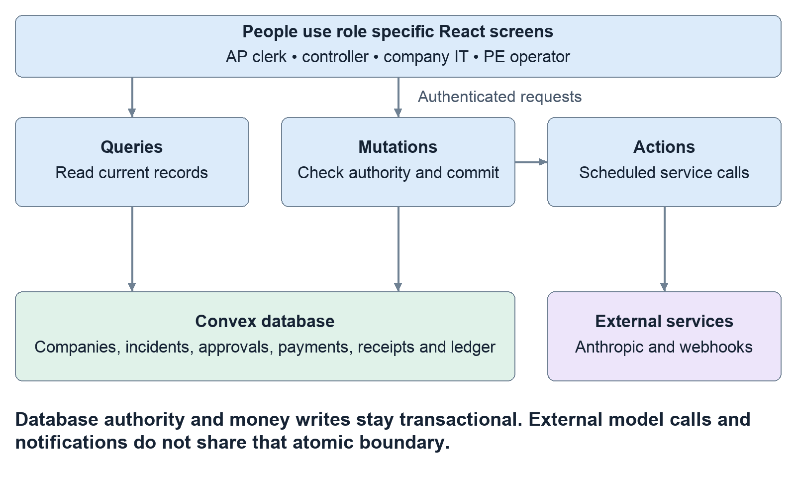

Read the diagram from the browser to Convex. Authority stays inside the mutation box; Claude and external services cannot grant themselves permissions.

**Code map:** `src/main.tsx:9`; `src/panels/CompanyView.tsx:41`; `convex/access.ts:14`; `convex/convex.config.ts:5`.

## Why transactions and scheduling matter

A transaction is a group of changes that succeeds together or does not commit. If a valid release records a payment as paid, it must also record the corresponding ledger movement and audit evidence. Recording only half would leave an inconsistent financial story.

Incident intake uses one mutation for its immediate core consequences: accepting the report, deciding exposed companies, holding eligible payments and writing the related records. This avoids a moment where the database says an incident exists but only some selected companies received its core controls.

External services cannot be folded into the same database transaction. Claude might be slow; a webhook might fail. Instead, the mutation writes its records and schedules work. A later action performs external communication and writes its result back through a mutation. Consequently, an alert can have temporary template wording while the underlying hold already exists. A model outage must not erase the hold or invent permission to release it.

Scheduled access work rechecks authority when it executes. A company may have changed its policy, the detector may have expired, or the incident may have been contained while the job waited. The old scheduling decision is not permanent permission.

**Failure lesson:** If wording or notification delivery is delayed, inspect the payment and response records separately; those are different stages with different failure conditions.

**Code map:** `convex/incidents.ts:49`; `convex/payments.ts:371`; `convex/responses.ts:199`; `convex/alerts.ts:64`; `convex/notify.ts:56`.

## The data model what each record means

A table is a collection of similarly shaped records. An ID connects one record to another. The most important relationships are:

| Group | Records | What they represent |
| --- | --- | --- |
| People and business | `companies`, `users` | Which business a person belongs to and which role they hold. |
| Relationships | `assets`, `links` | The vendor/service/login, and exactly how a company uses it. |
| Security reports | `detectorSources`, `incidents`, `incidentReports` | Who may report, the grouped incident episode, and receipts for individual reports. |
| Company impact | `exposures`, `alerts` | One company's review item and its explanatory messages. |
| Response permission | `responsePolicies`, `responseSteps` | The company's standing rules and the steps created for an incident. |
| Money | `bills`, `payments`, `bankDetailChanges`, `ledgerEntries` | Debt, attempted settlement, recorded destinations and accounting movements. |
| Purchasing | `purchaseMandates`, `purchaseQuotes`, `purchaseRequests`, `purchaseReceipts`, `purchaseRuns` | Controller authority, pinned bill facts, replay protection, outcomes and the bounded Claude job. |
| Supporting evidence | `investigations`, `paymentRecoveries`, `auditLog` | Document comparisons, correction proposals and who did what. |
| Communication/test resources | `notificationChannels`, `notifications`, `sandboxResources`, `agents` | Destinations, delivery outbox, owned test access and scoped assistant credentials. |

Convex Auth adds account/session tables. An index is a prepared lookup, such as “payments for this company with status held”; it is not a separate business record. Many lists and exports have explicit limits. The ledger screen lists its latest 200 entries while calculating balances across all of that company’s ledger entries. The demo has not established unlimited-scale processing.

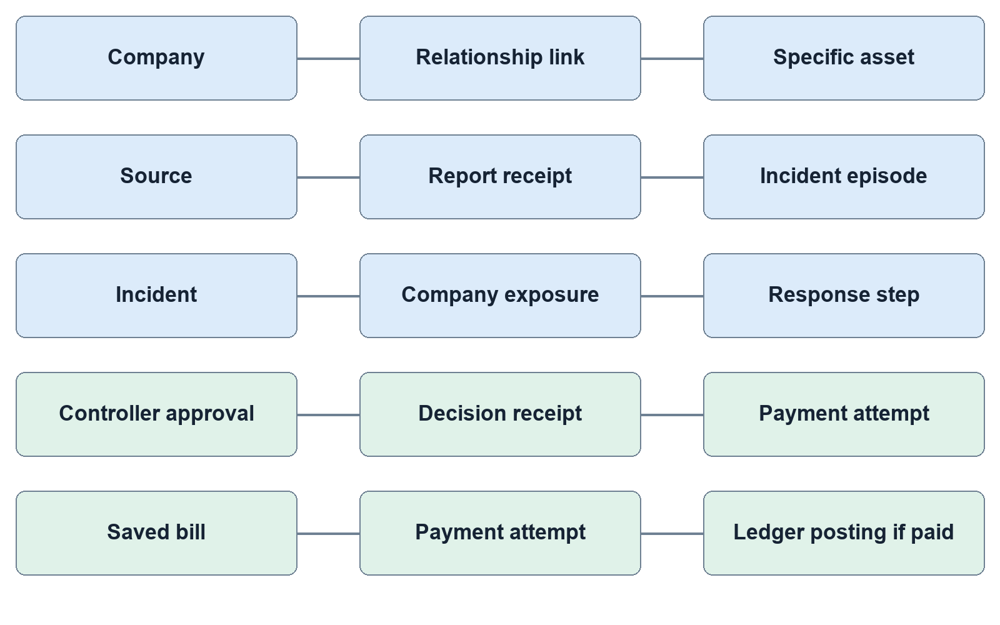

Read each connecting line as “this record refers to that record.” A payment can connect to its bill, company, vendor asset and the incident holding it. These references let the evidence view explain one decision without treating every record as the same thing.

**Code map:** `convex/schema.ts:172`; `convex/schema.ts:206`; `convex/schema.ts:258`; `convex/schema.ts:342`; `convex/schema.ts:425`; `convex/schema.ts:575`.

## People screens and privacy

There are four application roles. A PE partner sees the portfolio, including the reporting company and full finding. An AP clerk requests their company's payments. A controller grants bounded purchasing approval and decides their company's held payments. An IT lead handles their company's access-response work. The PE partner cannot release company money; an AP clerk cannot approve their own release.

The initial website password is only a convenience screen in the browser. It is not the security boundary. Convex Auth supplies the session, and backend functions use that session to find the user's role and company. The demo deliberately uses seeded identities and a shared demo password. That is a demonstration arrangement, not a production identity-management design.

Company users do not receive the firm's full incident record. Reporter identity, sender-controlled summary and identifying external report IDs are removed or replaced. Sister-company advice is built from Sidecall's own relationship records, rather than copying another company's private attack-path labels. Demo mode has an explicit exception: the quick-pick directory is public so visitors can choose a simulated person.

Finance users initially see held-payment work. Their tabs include Incident & evidence, Held payments, Bills to pay, Response playbook, Timeline, Controls log, Ledger and Slack & alerts out. The firm receives portfolio-level map, alerts, payments, timeline, onboarding and proof views. Some sections change when there is no incident or only an observation. The URL hash remembers the selected tab.

**Failure lesson:** A hidden or refused action may be correct permission enforcement. Changing a button in React cannot bypass the server's role check.

**Code map:** `src/auth/SiteGate.tsx:1`; `convex/auth.ts:13`; `convex/access.ts:14`; `convex/blastRadius.ts:22`; `convex/blastRadius.ts:226`; `src/panels/CompanyView.tsx:94`; `src/panels/PortfolioView.tsx:90`.

## DNS and AP imports supply relationships not magical certainty

The DNS scripts inspect public MX, TXT/SPF and selected CNAME records. A recognizable provider hostname can suggest that a company uses a vendor. It cannot prove shared credentials or a weakness. Real-domain findings are saved for the proof display; fictional seed records produce separate candidate links. These are script-produced files bundled into the application, not continuous live scanning from the dashboard.

The AP import is a different path. The PE partner uploads a vendor master and open-bills CSV, previews the parsed result, then imports a new company. The backend accepts common column names, checks required values and reports skipped invalid rows. It caps files at 200 vendors and 500 bills. Matching normalizes vendor names; ambiguous matches are refused instead of guessed.

On import, the system creates the company, distinct AP/controller demo identities, vendor links, booked bills and pending payments. Links created from the AP file mean “same vendor only,” not shared administrator access. A bank suffix differing from the latest phone-confirmed record generates a preview warning. If an imported payee is under an active confirmed incident, eligible payments are held immediately and relevant exposure records appear.

This is real CSV parsing and database integration, not a live QuickBooks/NetSuite connector. It does not independently verify that uploaded vendor information is true. Review the preview and reported problems; a successful import can still have skipped invalid rows.

**Code map:** `scripts/dns/scan.mjs:1`; `scripts/dns/portfolio.mjs:1`; `convex/imports.ts:22`; `convex/imports.ts:115`; `convex/imports.ts:232`; `convex/imports.ts:257`; `src/panels/ApImportPanel.tsx:29`.

## What the proof screens can and cannot prove

The proof page loads saved DNS and scorecard files. The scorecard compares backend outcomes against authored expected cases; the backend does not read that answer key to decide what to do. Missing reference cases cause scoring to fail rather than passing silently. A result of zero misses on these fixtures is useful regression evidence, not universal fraud-detection accuracy.

Live run reports, mocked unit tests and screenshots answer different questions. Unit tests exercise known branches. A live report records an actual run against a named backend. A screenshot proves what a particular screen displayed. None alone proves the current production website is correctly configured. Reports should retain the source commit, deployment, timestamps and cleanup outcome so the team can tell which evidence applies.

The alerts and vendor-letter draft are another separate layer. Writers use matching cached text, a configured live model or deterministic fallback wording. Failure there does not reverse the underlying transaction. A draft is not a sent email. External notification delivery is also optional; with live sending disabled, outbox rows are marked simulated. Delivery recovery can repeat a remote message after an uncertain crash, so do not claim globally exactly-once Slack delivery.

**Learning check:** Explain one successful action using four things: its trigger, the authoritative backend decision, the stored record and the visible result. If one is missing, say what is still unverified.

**Code map:** `src/panels/ProofPanel.tsx:69`; `scripts/scorecard/score.mjs:71`; `convex/scoring.ts:219`; `convex/ai.ts:88`; `convex/notifications.ts:314`; `convex/notifications.ts:348`; `convex/notify.ts:56`.

# 4 The graph and its scores which companies are connected

## How the graph and scores are produced

The database graph consists of companies linked to particular assets. On intake, Sidecall looks up the affected asset's links and applies deterministic rules. It does not crawl every internal computer or infer an unlimited chain of attacks.

A shared credential starts at 90 priority points; shared administrator access starts at 80; being a customer of the same vendor starts at 40. Self-reported links use full weight. Public-DNS candidates use 0.75 weight. One or more held payments with a recent destination-change flag add a single 30-point increase to that company’s score, with a maximum score of 100. A score of at least 70 is urgent. Displayed confidence is 0.9 for self-reported evidence and 0.5 for DNS inference. These are configured priority/provenance values, not measured probabilities that someone has been hacked.

The default G6 map reorganizes backend results into an expandable radial tree: parent firm, vendor, reporter, exposed companies and other companies. Click a company to open evidence; expand bubbles, drag and zoom to navigate. The lines organize the presentation; they are not packet routes or proof of lateral movement. `?map=classic` selects the earlier SVG view, which exposes finer relationship distinctions.

A source finding may describe a tested path. Sister companies remain “reachable, not tested.” Current map shorthand such as “breached” must not override the finding's actual evidence class. An observation is not a confirmed compromise, and an exposed company is not automatically a breached company.

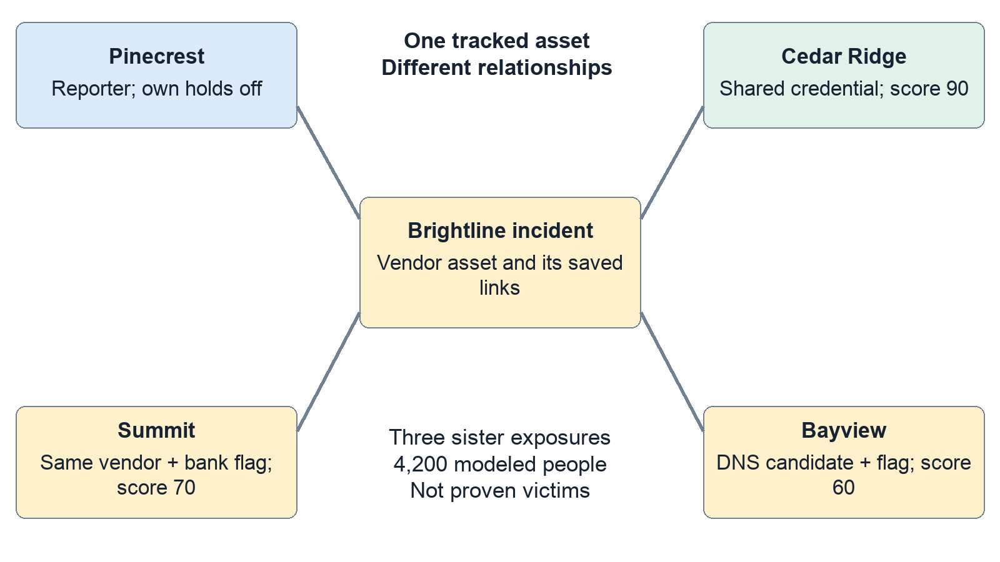

**Code map:** `convex/scoring.ts:10`; `convex/scoring.ts:61`; `convex/blastRadius.ts:61`; `convex/blastRadius.ts:173`; `src/panels/G6BlastMap.tsx:31`; `src/panels/PortfolioView.tsx:267`.

## A concrete Brightline example

Fresh seed data contains fourteen companies. In the Brightline vendor incident, Pinecrest reports the problem. Cedar Ridge, Summit Home Health and Bayview are the three sister-company exposures. Their modeled headcounts total 4,200. This is an exposure population, not a count of confirmed victims.

Four pending payments are held: Summit $480,000, Cedar $92,000, and Bayview $28,000 plus $12,000. Total: **$612,000**. Summit's destination ending 7731 changed two days before seeding; Bayview's 4419 changed nine days before. Those payments get flags. Cedar's 2208 record is older, so its payment is held without a recent-change flag. A flag means “verify this change,” not “fraud proven.”

Cedar scores 90; Summit scores 40 + 30 = 70; Bayview scores 40 × 0.75 + 30 = 60. Bayview can have held money while its relationship is a candidate: its saved payment plus an opted-in vendor hold policy independently justify holding that payment. Advisory does not mean safe.

Already-paid money is unaffected. Pinecrest's pending payment stays untouched because that company's hold switch is off. Requesting Summit's separate $38,000 bill later during the incident raises the held total to $650,000. These totals describe different moments.

**Expected result:** on fresh data, the original Brightline flow should produce three sister exposures, 4,200 people and $612,000 held before additional requests/imports/releases.

**Code map:** `convex/seed.ts:75`; `convex/seed.ts:182`; `convex/seed.ts:201`; `convex/seed.ts:265`; `convex/payments.ts:170`.

# 5 Incident safety accepting reports without repeated disruption

## How a report enters the system

The main external entrance is `POST /incident`. The HTTP handler bounds the body, validates its shape and chooses an authentication path. A named detector uses a bearer credential; only its hash is stored. That detector has an expiry, revocation state, permitted assets, permitted reporter domains and either observe or confirm authority. Legacy signed HMAC reports are also supported. The presenter can fire built-in synthetic scenarios through a restricted demo route.

Three questions remain separate: **Who sent it? What do they claim? What are they allowed to trigger?** A valid signature proves possession of a credential, not that a breach is true. A detector's evidence references are submitted pointers; Sidecall does not independently investigate every reference.

Ordinary signed reports become observations unless the configured authority permits a confirmed path. A named confirm-capable source must request a confirmed assessment and supply evidence references. An observe-only source cannot promote itself merely by writing “confirmed.” Alternatively, the PE partner can review an observation and record an independent-evidence note of at least 30 characters.

An observation creates an explicitly unconfirmed warning. It does not hold payments or execute access-response steps. Confirming an observation closes its warning-only record and evaluates the confirmed response path: it creates a confirmed episode if none is active, or adds evidence to an existing active episode for the same asset and response class without restarting its actions. A malformed, expired, revoked or out-of-scope credential is refused; an invalid named credential cannot fall back to the demo route.

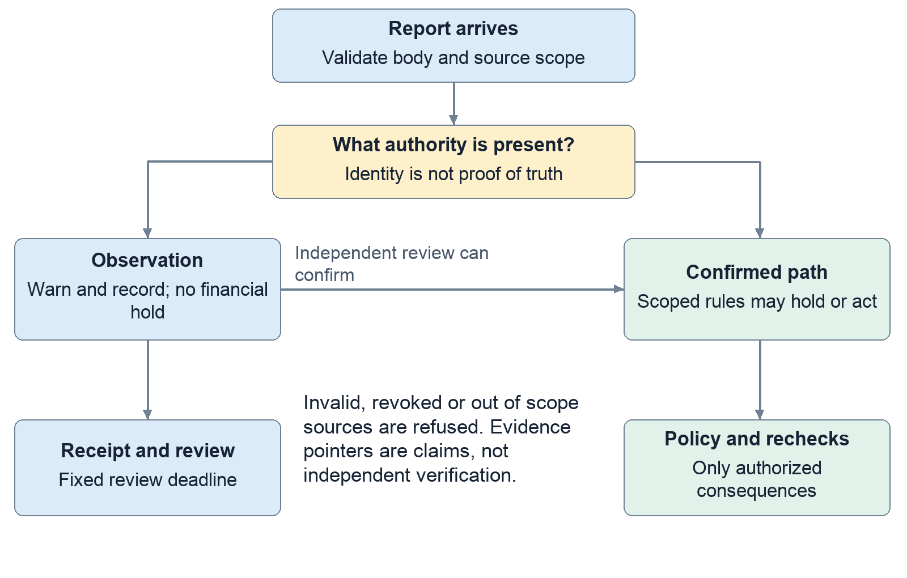

**Code map:** `convex/http.ts:100`; `convex/http.ts:163`; `convex/detectors.ts:218`; `convex/incidents.ts:223`; `convex/incidents.ts:487`.

## Why repeated little reports do not automatically keep freezing everyone

Your repeated-attack concern is an availability problem: the defensive system itself could be used to interrupt normal business. Sidecall addresses specific amplification patterns rather than claiming every denial-of-service attack is impossible.

Every accepted source/report-ID pair receives a receipt. Replaying that ID returns the historical result. Sending new IDs does not automatically create fresh response campaigns either: the server groups reports by the affected asset and response class into an active episode. It adds report receipts and counters without repeating the original holds and access actions.

Each named detector has its own intake bucket, allowing a burst of ten requests and refilling at thirty per minute; legacy HMAC senders share a separate bucket. Exact incident-report replays consume this intake quota too. Firm messages are grouped into fixed 15-minute intervals. The episode receives a review deadline fifteen minutes after creation; later reports cannot postpone it. This scheduled review asks the firm to inspect evidence and business impact; it does not release money. Payment-request retries and model-job starts have different quotas, explained in chapters 9 and 10.

There are two different 30-day clocks. Correlation uses recent reporting activity to decide whether an episode remains active. The window for holding newly requested vendor payments is tied to the confirmed vendor episode’s original creation time. Repeated reports do not restart that financial window. Payments already held do not automatically release when any timer expires.

A dishonest confirm-capable source can still submit bad claims within its authority, and genuinely different assets or new episodes can cause new work. The controls limit repeated effects; they do not establish the truth of every security claim.

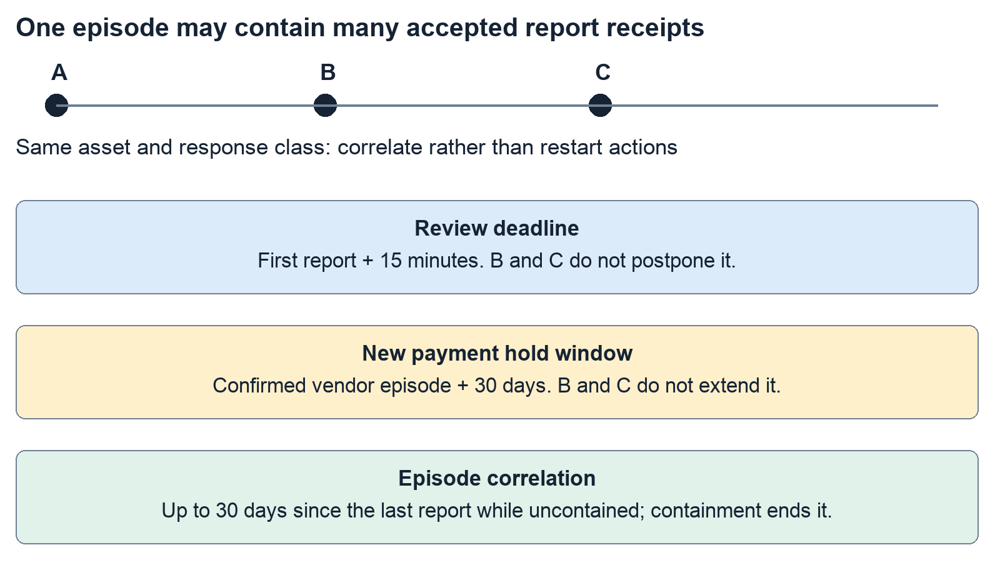

Reports A, B and C about the same asset and response class can produce three receipts but one active episode and response set. The review deadline stays anchored to that episode’s creation. The financial window belongs to the confirmed vendor episode and does not start with a preceding observation.

**Code map:** `convex/incidents.ts:26`; `convex/incidents.ts:67`; `convex/incidents.ts:107`; `convex/incidents.ts:166`; `convex/shared.ts:8`; `convex/payments.ts:210`.

# 6 Response automation permission before execution

## Automatic response requires a policy first

Access response has three modes: **notify** tells the company what to do; **prepare** creates a step awaiting approval; **act** runs a step under a previously adopted policy. The two actions are pausing a shared login and revoking a vendor's app tokens. The payment-hold switch is separate.

The effective action is the company's preference reduced by a safety ceiling. Same-vendor-only relationships do not justify shared-access actions. DNS guesses are capped at notify. Pausing payroll access or shared administrator access is capped at prepare. A confirmed shared credential on an eligible non-payroll asset can act automatically. At most three companies get automatic access steps from one incident planning pass; further eligible steps require approval. That cap does not limit payment holds to three companies.

Raising an access policy requires two different authorized company users. This includes notify → prepare, not only prepare → act. A proposal alone changes no authority. Lowering the mode needs one authorized user. Company IT leads and controllers can approve or undo access steps; AP clerks and the firm cannot do so.

Before execution, the worker rechecks company policy, episode state and detector authority. Revoking a detector can invalidate waiting work, but it does not silently undo already completed actions or release held money.

**Expected Ironclad contrast:** Cedar's pre-approved eligible shared-login pause can run automatically. The same preference against a payroll login becomes a prepared task. This difference is intentional.

**Code map:** `convex/responses.ts:30`; `convex/responses.ts:80`; `convex/responses.ts:209`; `convex/responses.ts:310`; `convex/responses.ts:439`; `convex/scoring.ts:194`.

## Simulation sandbox acknowledgement and containment

Without an external identity connector, access completion is recorded as simulated. With `RESPONSE_SANDBOX=true` and an explicitly provisioned owned resource, Sidecall really changes the authorization state of that test resource. A test credential can receive HTTP 200 before a pause and 403 afterward. This proves enforcement at Sidecall's test endpoint, not suspension of a real Okta, Entra or Google account.

Undoing a pause can restore sandbox access. Revoked tokens cannot be resurrected; they need replacement. A newer response on the same target can prevent undoing an older one. The saved verification records owned-resource state, not a signed external-provider attestation.

Acknowledging an exposure means someone saw the review item. Closing it means that company's review item is finished. Neither action releases money or contains the incident. The firm can mark an incident contained with a remediation note. New payments then stop being held by that episode, while already-held payments still need separate controller decisions. Waiting response work expires; a completed pause remains until the company restores it.

**Failure lesson:** “Acknowledged,” “contained,” “done,” “undone” and “paid” belong to different records. Never use one as proof that all the others happened.

**Code map:** `convex/sandbox.ts:15`; `convex/sandbox.ts:115`; `convex/responses.ts:346`; `convex/incidents.ts:636`; `convex/incidents.ts:654`; `convex/incidents.ts:670`.

# 7 Money holds and verified release

## First separate the code the running website and the demonstration

This chapter describes the code inspected at commit `d6d6f82`, including the purchase-console work submitted in PR #132. It does not establish that the public website has the same code or configuration. A feature can work on Pegasus’s development backend and still be absent or unavailable on the website because its frontend, backend or environment variables differ. Before diagnosing a missing feature, identify the frontend version, Convex deployment and signed-in role.

The recorded Claude demonstrations used Pegasus DEV, `tangible-koala-842`. A working key there does not configure production. The repository’s handoff assigns production review and deployment to Adrian. Read the latest handoff before running a demonstration; older entries describe older branches and earlier results.

Sidecall’s payment system is a **synthetic ledger**. It records demonstration accounting in Convex. It does not charge a Visa card, contact a bank or transfer real money. A real Claude API call can incur provider usage, but that is separate from a simulated invoice settlement.

Four words will prevent most confusion. A **bill** is an obligation to pay a vendor. A **payment** is a request to settle a bill. An **approval** gives narrowly defined permission. A **receipt** records what the server decided and why. These are different records: creating one does not imply all the others exist.

*Code: `convex/purchases.ts:1`; release status: `handoff/pegasus.md`; development evidence: `docs/pegasus-purchase-console.md`.*

## The people and their permissions

An accounts-payable clerk, or AP clerk, prepares payment requests. A controller authorizes spending and reviews exceptions. In the seeded Summit Home Health company, Jamie Chen is the AP clerk and Rosa Alvarez is the controller. The requester cannot also approve the same held payment.

This separation still applies when an assistant is involved. Claude cannot make itself the controller by writing “approved” in a message. An external assistant’s credential represents a particular company user, with a limited tool list. The server checks the user’s current role and company.

A disabled button can therefore be correct behavior. Rosa should see approval controls, but not an AP purchase-launch action. Jamie should see eligible request actions, but cannot grant his own approval. A firm-level portfolio view does not automatically grant authority to spend a subsidiary’s money.

*Code: `convex/seed.ts:167`; `convex/payments.ts:234`, `:333`; `convex/agents.ts:135`.*

## What the payment statuses mean

A bill may exist without any payment request. Once requested, a payment has one of four states.

| State | Meaning | Has this request reduced cash? |
|---|---|---|
| Pending | Saved request awaiting further handling | No |
| Held | Saved request blocked for verification | No |
| Paid | A synthetic settlement was recorded | Yes, in the demo ledger |
| Rejected | A controller refused this payment attempt | No |

“Refused” is also a possible **request result**. It can mean that no payment was created. However, refusal of automatic purchasing permission may sometimes fall back to a pending or held request. Always inspect the result’s payment ID and status instead of treating every refusal receipt as the same event.

The normal flow is: saved bill → AP request → server checks → paid, pending, held or refused. A held request can become paid after a separate controller verifies it, or rejected after that controller refuses it. Rejection does not erase the bill. The company still owes the underlying obligation unless another business process changes it.

The release API specifically handles **held** payments. Do not assume that every pending payment has the same release button. “Pending manual handling” describes an unsettled state; it is not a claim that a complete general-purpose payment-approval workflow is implemented.

*Code: `convex/payments.ts:256`–`:290`, `:342`, `:458`.*

## How the ledger accounts for money

The ledger is a record of balanced accounting entries. It is not a bank account. Each entry has a debit and an equal credit. The code uses integer cents: $180 is stored as 18,000 cents.

| Event | Debit | Credit | Plain-language result |
|---|---|---|---|
| Start with $5 million | Cash | Equity | Record opening demo funds |
| Save a $180 bill | Expense $180 | Accounts payable $180 | Record a cost and a debt |
| Settle that bill | Accounts payable $180 | Cash $180 | Reduce the debt and cash |

“Debit” does not always mean money leaves. In this model, paying a bill **credits cash** and **debits accounts payable**. Accounts payable means the company’s unpaid bills.

Approving a mandate, placing a hold or rejecting a payment does not create a payment ledger entry. An ordinary pending request also leaves cash unchanged. A request covered by valid automatic authority can settle immediately and does create the payment entry. If the $480,000 example is held, the cash remains available in the ledger and the debt remains outstanding. Releasing it reduces both by $480,000. Rejecting the attempted payment changes neither.

A balanced entry is necessary but insufficient: an unauthorized payment could also balance. Sidecall therefore links the entry to the payment, approval, decision evidence and actor. The receipt explains permission; the journal explains the accounting.

*Code: `convex/ledger.ts:5`–`:35`; `convex/payments.ts:429`, `:480`.*

## Why a security incident holds a payment

A confirmed vendor incident can hold pending payments to that vendor at companies that enabled the hold rule. The system does not freeze every payment at every company. Unrelated vendors can continue.

A recent bank-detail change is additional context. The hold code flags a payment when its destination matches a bank record changed within the incident’s 30-day window. The flag means “verify this change,” not “fraud has been proven.”

The seeded example makes this visible. Summit has a $480,000 Brightline payment to account ending **7731**, recently added through email. An older record ending **2208** was marked verified by call. These are synthetic records. The incident holds the pending payment, adds reasons and highlights the bank change.

Because that example is due in 20 hours, Sidecall escalates it to a controller. A scheduled check also finds undecided holds approaching their due dates every 15 minutes. Escalation means “a person needs to act”; it does not release money automatically.

Repeated observations do not create a universal company freeze. This function acts on pending payments, so it does not newly hold already-paid payments. The active-incident lookup excludes observation and credential-finding classes from the confirmed vendor-hold path and uses the original 30-day incident window. These are specific protections, not a guarantee against every denial-of-service technique.

*Code: `convex/seed.ts:183`–`:207`; `convex/payments.ts:23`, `:99`, `:168`, `:209`.*

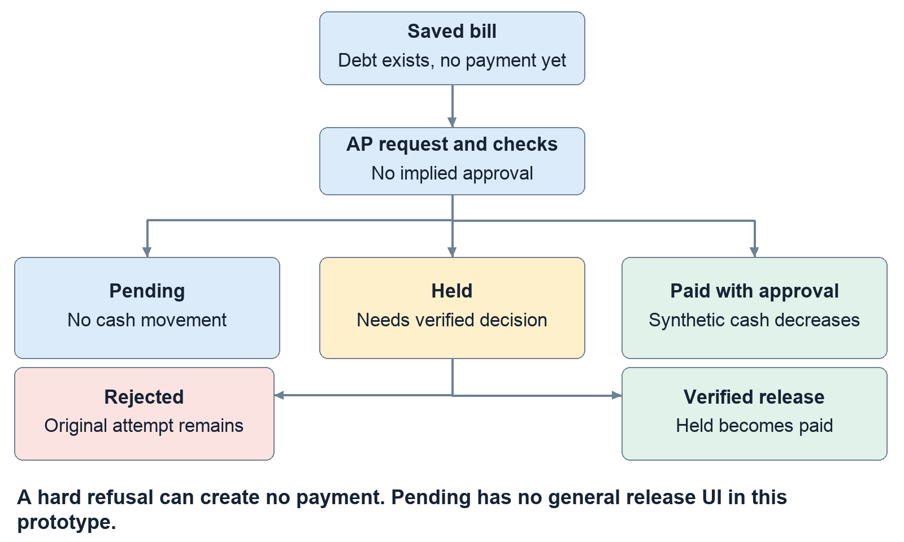

## Releasing a hold safely

Before release, the payment must be held and the signed-in person must be a controller at the same company, different from its requester. The controller reviews the exact amount, destination and trusted callback information.

The controller supplies three things: the confirmed destination’s last four digits, an assertion that they called the stored number, and a 15–2,000-character note describing the verification. The server compares the payment, bill, vendor phone and bank context with the version the controller reviewed. If those details changed meanwhile, it refuses the stale verification.

The suffix must match **this payment’s destination**. If the held request points to 7731 but the trusted callback confirms 2208, entering 2208 cannot release the 7731 request. Reject the incorrect request and prepare a correction.

Before posting money, the server also checks that another payment has not already paid this bill. The paid status, ledger entry, verification record and audit log commit together. Two simultaneous release attempts cannot legitimately create two settlements of the same bill.

The limitation is important: the checkbox records the controller’s assertion that a call occurred. The software does not place the call or prove it happened. Four digits identify a masked demo destination, not a complete independently authenticated bank account.

If release fails, read the specific reason. Wrong role, self-approval, a stale review, mismatching digits, missing callback assertion or an inadequate note are different problems. Do not repeatedly click Release while changing random fields.

*Code: `convex/paymentVerification.ts:7`, `:92`; `convex/payments.ts:371`–`:455`.*

# 8 Recovering a rejected payment

Recovery preserves the original mistake as history. It does not edit the rejected request into a different payment or silently change the vendor’s master bank record.

Start with the newest rejected attempt for that bill, a retained incident and no existing live or paid payment. A controller distinct from the AP requester can prepare a correction to the most recent bank record previously marked verified by call. That destination must differ from the rejected destination, and the controller must perform and record a current callback.

The proposed correction expires after 15 minutes. The UI exposes the age of the prior verified record and later bank changes, because “verified in the past” does not establish that it is correct today. Preparing the correction moves no money.

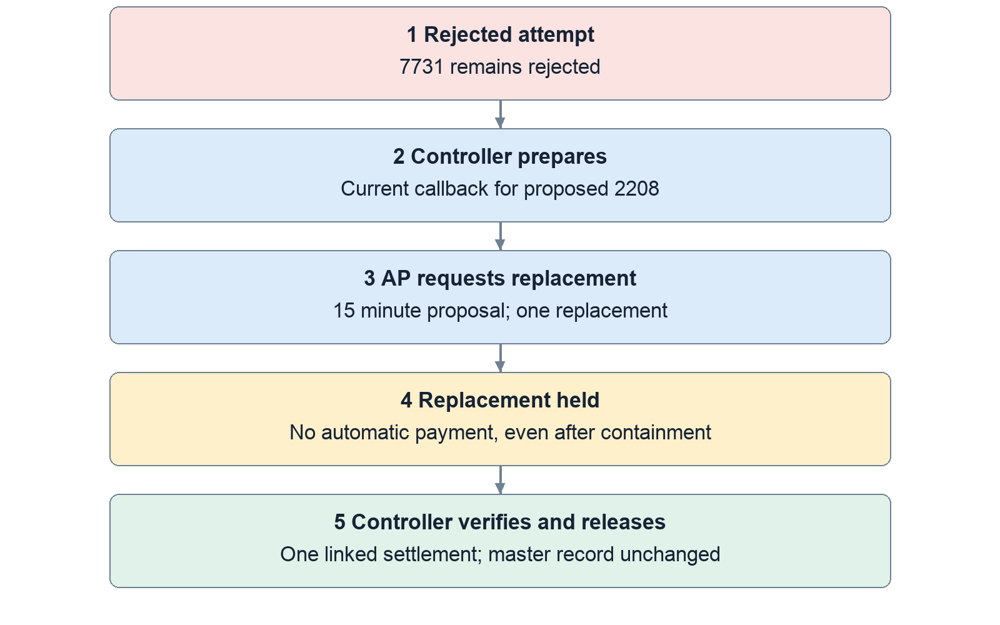

A separate AP clerk then requests the replacement. The server rechecks the controller’s authority, bill/context, destination and expiry. The replacement is **always held**, even if the incident was contained or there is an automatic purchase approval. A controller must separately verify and release that exact replacement.

Thus the example is: reject 7731 → verify proposed 2208 → save a short-lived proposal → AP requests a new held payment → controller releases the exact replacement. The original stays rejected. Repeated submission of an already-used proposal returns the same replacement ID.

An unused prepared proposal can be revoked. Once it created a replacement, use the held payment’s decision controls. Expired or stale proposals require fresh verification, not a timestamp workaround.

*Code: `convex/paymentRecovery.ts:34`, `:96`, `:133`, `:178`.*

# 9 Bounded purchasing permission before automation

## Approving safe purchases in advance

Automatic purchasing uses a **mandate**: a saved controller approval. Think of it as permission to buy particular items under particular conditions, not permission to spend freely.

The controller selects 1–25 different unpaid bills from exactly one vendor. The vendor must have a current bank record marked verified by call and no active confirmed incident. The controller chooses a per-purchase limit and total budget. Both must be positive whole-cent amounts at most $1 million, and the per-purchase limit cannot exceed the total budget. The UI currently creates a one-hour approval; the backend permits at most 24 hours.

The approval saves copies of each bill’s amount, vendor, description and due date. It also pins the bank record’s ID, timestamp and suffix. A different bank record with the same visible four digits is therefore not interchangeable.

The grant may cover the company’s AP clerks or one specific external payment agent. A grant limited to one agent cannot be used by a human session pretending to be that agent.

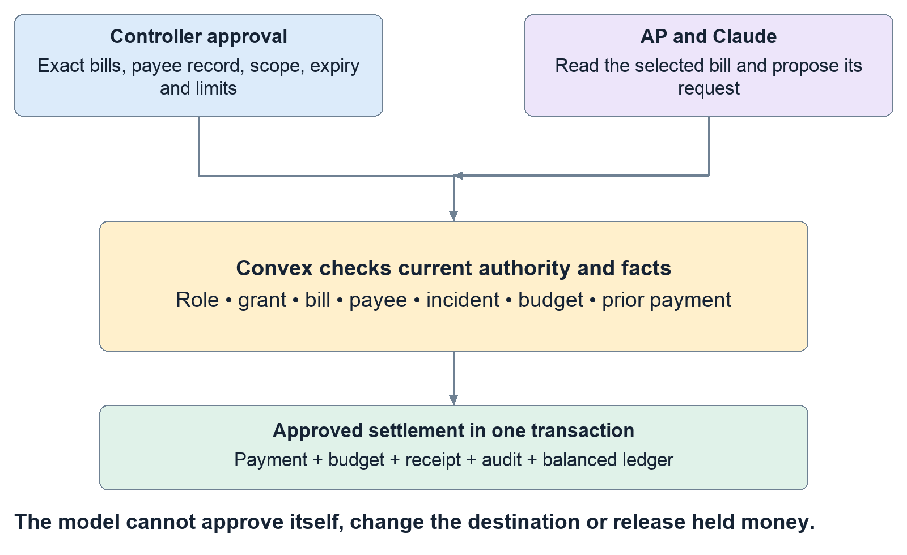

Approval itself reserves no money. The actual request must pass fresh server checks. The UI preview runs the same evaluator but does not reserve budget or authorize a later transaction.

The evaluator records these fifteen checks. The names in the left column are the identifiers you may see in exported evidence; the right column explains them.

| Evidence identifier | What must be true |
|---|---|
| `demo_only` | Settlement is running in the synthetic demo ledger. |
| `requester_role` | The current requester is an AP clerk. |
| `approver_authority` | The original approver is still this company’s controller and differs from the requester. |
| `executor_authority` | Any requesting agent remains active and authorized to request payments for this AP clerk. |
| `executor_scope` | The requester matches the grant’s company-wide or specific-agent scope. |
| `controller_rejected` | No newer rejection invalidates this bill’s saved approval. |
| `approval_inactive` | The approval is neither expired nor revoked. |
| `approval_changed` | An explicitly selected approval is still the effective approval. |
| `confirmed_incident` | No active confirmed vendor incident blocks automatic settlement. |
| `bill_not_approved` | This exact bill was included in the controller’s selected bills. |
| `bill_changed` | Vendor, amount, description and due date still match the approved copy. |
| `payee_changed` | Bank-record identity, timestamp, suffix and verification channel still match. |
| `purchase_limit` | The bill fits the individual purchase limit. |
| `total_budget` | The bill fits the remaining aggregate budget. |
| `existing_payment` | The bill has no pending, held or paid payment already. |

Some identifiers describe the failure they detect: for example, `bill_changed` passes when the bill has **not** changed. Read each check’s `passed` value and explanation together. A receipt retains all checks, even when the first failure supplies the main refusal reason.

*Code: `convex/purchases.ts:19`–`:124`, `:203`–`:251`; `src/panels/PurchaseControls.tsx:225`.*

## A small example your whole team should reproduce conceptually

The Northstar sample contains SC-101 for $120, SC-102 for $180 and SC-103 for $210. Its synthetic payee ends in **4242**.

Suppose Rosa approves all three, with $250 per purchase and $300 total. Jamie requests SC-102 for $180. If all saved facts still match, it settles and $120 of authority remains. SC-101 can then settle for $120. Total spending reaches $300.

SC-103 cannot automatically settle after the $180 because $180 + $210 exceeds $300. Its $210 amount is below the individual cap, but the aggregate budget still blocks automatic settlement. It can fall back to a pending request; that does not mean another $210 left the ledger.

Selecting $510 of eligible bills under a $300 budget is intentional. The selection defines which bills may qualify; the total budget limits which combination can actually settle.

The suffix 4242 is not a charge on your real card. It is the saved four-digit value in the sample bank-detail record. It also appeared in the earlier synthetic release demonstration. Determine which payment/run is on screen instead of treating all 4242 examples as one event.

*Code: `convex/purchases.ts:378`–`:438`; `convex/ledger.ts:5`.*

## What happens when circumstances change

If the amount, vendor, description, due date or approved bank record changes, automatic purchasing refuses the mismatched evidence. Even a description edit matters because it changes the bill the controller approved.

An expired, revoked, out-of-scope or insufficient-budget grant can fall back to ordinary pending handling. A confirmed incident can instead produce a held request when holds are enabled. A newly substituted approval that disagrees with the explicitly pinned approval is a different failure: the request must not silently adopt new authority.

Only the newest grant for a vendor is effective. Revoking it does not reactivate an older grant. Rejecting a bill can revoke its effective automatic authority; a fresh controller approval must explicitly restore eligibility after that rejection.

Concurrent requests are handled inside transactions. They cannot both consume the same remaining budget or independently pay the same bill. If revocation commits first, a later request cannot automatically settle under the revoked authority. If settlement commits first, later revocation does not reverse the completed payment.

*Code: `convex/purchases.ts:178`, `:195`, `:203`; `convex/payments.ts:256`.*

## Retrying safely and controlling request volume

Idempotency means repeating the same operation does not create another business effect. For payment calls that supply a request ID, Sidecall stores the outcome under the company, executor identity (human or agent), and request ID. The same text ID used by another company or agent is not the same operation. Reusing it with the same bill and selected approval returns the stored historical result; reusing it for a different bill or approval is refused as a retry conflict.

That result is history, not renewed permission. A successful purchase remains its original outcome after the approval expires or is revoked. A request originally held can replay its original held result after a controller later releases it; inspect the current payment and ledger for the later decision. Revoked MCP credentials still fail authentication, and the requester must retain the AP role. A genuinely new identity is evaluated against current facts.

The console supplies its own stored payment request identity. MCP callers may supply one. The direct Bills to pay Request button currently sends only a bill ID, so it does not promise historical-result replay. Its duplicate protection is the transactional existing-payment check; another attempt reports that the bill already has a payment.

New payment requests use a separate per-caller quota: burst ten, then refill twenty per minute. Each agent has its own bucket, separate from its human owner. Exact stored retries are answered before new quota is consumed and create no extra receipt, journal or duplicate MCP audit row. A quota refusal creates no payment. This is separate from the console’s lower quotas for starting model jobs and the detector intake quota.

Code: `convex/payments.ts:234`; `convex/purchaseLimits.ts:6`; `convex/agents.ts:232`; `src/panels/BillsPanel.tsx:93`.

# 10 The Claude purchase console and external assistants

## Running the in app Claude feature

The in-app console requires the matching frontend and backend, demo mode, a configured server Anthropic key and presenter key, an AP session, and an eligible company-wide AP approval. These prerequisites are separate. A working sign-in or API key alone is insufficient.

As the controller, approve the intended saved bill. Switch to the AP clerk, open Bills to pay and choose that bill in the purchase console. Paste masked invoice/email text. The “Use saved bill as demo source” helper creates explicitly synthetic source text; it is useful for a reproducible demo, not evidence that an external invoice was independently checked.

Enter the presenter key and click **Process approved bill**. This key authorizes paid model usage; it grants no financial permission. The server saves the source, its hash, the bill snapshot, authenticated requester, current grant and stable request identity. The screen should then show a durable execution record.

Claude first reads the selected saved bill. It then either requests that exact bill or declines. Its only offered tools are `read_selected_bill`, `request_payment` and `decline_purchase`. It cannot approve, release a hold, edit accounts or call Visa.

The server rejects unfamiliar tools, extra authority fields, different amounts/payees/bills and a payment attempt before the saved-bill read. It also independently checks recognized labelled vendor, amount and account fields in the source. Claude’s instruction-following is therefore not the only protection.

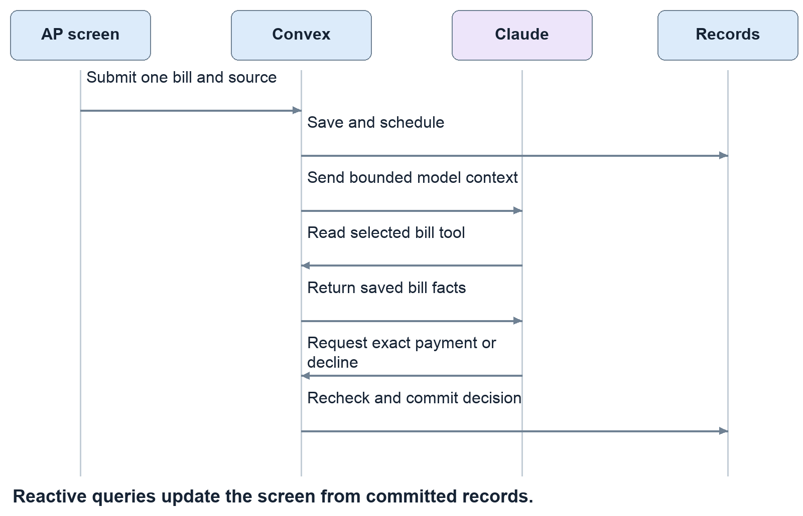

Successful execution shows an actual stored outcome and, where available, its receipt. “Paid” means the transaction settled in the demo ledger. “Held” and “Pending” explicitly mean no automatic cash movement. The trace shows calls and tool results, not hidden model reasoning. Completed source/trace details can expand, and the run can export evidence.

*Code: `convex/purchaseConsole.ts:70`, `:163`; `convex/purchaseConsoleLogic.ts:15`; `src/panels/PurchaseConsole.tsx:286`.*

## Console failures cancellation and duplicate submissions

A page reload does not erase the job. Convex schedules the work and stores updates. Duplicate submissions with the same requester, company, bill, source and request identity return the original job. Only one worker can claim it. An uncertain browser response should retain that identity for a safe retry. The saved job survives reloading, but the form does not persist its draft source and submission ID across a reload. After reloading, inspect the active or recent execution record first; a fresh form may use a new identity.

Each AP clerk can have one active job. A job expires after three minutes and allows at most four model calls, with a 35-second timeout and 1,400-output-token maximum per call. Start quotas refill at four per user per minute and eight per company per minute, with bursts of two and four. Invoice source is limited to 6,000 characters.

Stop prevents later execution if cancellation commits before the payment decision. A provider call already in flight may still incur usage. Stop cannot reverse a settlement that already committed. Provider errors likewise cannot rewrite a completed receipt into a different financial outcome.

For “not configured,” check the selected deployment’s environment without displaying secrets. For “prepare this bill first,” inspect approval eligibility. For a provider failure, inspect the stored run and payment before starting again. Repeatedly resubmitting new IDs is not a recovery strategy.

The source parser recognizes labelled contradictions; it is not a general proof that every malicious document will be caught. Use masked synthetic source in demos and never paste credentials.

*Code: `convex/purchaseConsole.ts:17`, `:114`, `:137`, `:204`.*

## What the eight visible control checks actually prove

After a run has actually created or returned a payment, its current AP requester can run eight checks. A declined source or hard refusal with no payment is not eligible for this replay test. The checks are: legitimate shape, forbidden release tool, substituted destination, inflated amount, different bill, forged authority/request identity, conflicting labelled destination and duplicate replay.

The first seven exercise the same argument/source guards used during execution. The final check actually replays the stored request and compares the payment’s journal before and after. These checks do not make eight additional Claude calls.

For a paid $180 request, journal count should remain one → one and cash outflow $180 → $180. That means no **additional** payment occurred. It does not mean the original $180 never moved.

The historical request result remains historical if a controller later releases a held payment. Look at the current payment and ledger for subsequent decisions. The check compares the current journal with itself before/after replay, rather than confusing old run status with current status.

*Code: `convex/purchaseConsole.ts:245`.*

## The AI pieces are separate

| Piece | What it does | Financial authority |
|---|---|---|
| Purchase console | Live Claude interprets one source and selects a narrow tool | Existing controller approval and Convex checks |
| External MCP assistant | An external client reads company bills/holds and requests payment | Same server evaluator |
| Alert writers | Produce notices and vendor letters | None |
| Evidence investigation | Extract and compare invoice facts | None |
| Teammates’ chatbot | Separate teammate-owned integration | Must be confirmed from its own implementation |

The console calls private Convex functions directly. The standalone `scripts/assistant` rehearsal instead calls real Claude locally and forwards client tools through Sidecall’s HTTP MCP endpoint. It is evidence of a separate connection, not proof that the chatbot is mounted in the UI.

MCP credentials are scoped to a company person and a tool list. The server stores a hash of the bearer token, rechecks revocation and current identity, and offers four tools: list held payments, explain a hold, list bills and request payment. There is no release or reject tool.

Alert writers first use cached text if the saved facts still match; otherwise they may use live Claude when enabled, or fall back to deterministic text. Those notices must not be described as fresh model calls merely because they sound polished.

Investigation uses labelled-text extraction first, with optional live literal-span extraction for unstructured input. It compares vendor, invoice reference, amount and masked account with stored records. “Consistent” means evidence aligns; it does not approve, settle, change the vendor master or release a hold.

*Code: `convex/mcp.ts:19`; `convex/agents.ts:20`, `:135`; `convex/ai.ts:38`; `convex/investigations.ts:93`, `:183`.*

## Evidence troubleshooting and the limits of the demonstration

Recorded development evidence is useful for identifying expected behavior. The console report records eight simultaneous submissions becoming one job, a real $180 Claude settlement, a malicious $120 source declined without payment, control checks and historical replay. A separate browser run submitted a legitimate $120 bill through the form. Both live runs are explicitly synthetic.

These reports refer to their recorded source commits and DEV deployment. Automated tests, earlier UI checks, live Claude calls and production verification are different evidence categories. Passing one does not establish the others. The reports are authored examples, not a guarantee of general fraud detection or complete attack coverage.

When something appears broken, record five facts before changing code: which URL, which Convex deployment, which user/company, which action, and which visible error or stored status. Then determine whether the failure is configuration, authorization, stale data, an already-completed example or an actual implementation defect.

Demo samples are not automatically fresh after every run. Paid bills remain paid, consumed approvals remain consumed, and rehearsal cleanup revokes temporary approvals. Reusing those same rows without understanding their state can look like a broken button. Do not reset a shared or production deployment to make a walkthrough easier.

The team should be able to explain why an approval is not a payment, why a hold is not fraud proof, why a hash is not document authenticity, why four digits are not full bank verification, and why Claude requesting something is not Claude authorizing it. Those distinctions explain both how Sidecall works and what still needs operational integration.

*Evidence: `scripts/console/report.json`, `scripts/console/ui-report.json`, `scripts/assistant/report.json`; documented release boundary: `handoff/pegasus.md`.*

# 11 Use the screens without guessing

## Sign in and choose the right environment

Open the team’s intended website or local build. The private-demo password screen comes before account sign-in. Its password is different from the presenter key and the Anthropic API key. The site password is a convenience gate in the browser; backend permissions still require a real signed-in session.

Choose a seeded seat under **Take a seat**, or use an allowed work email and password. Desktop navigation uses the left sidebar. The person menu at the bottom left lets you switch seats; mobile places it in the top bar. Sign-in is stored per browser tab, so two tabs can show different roles. A page refresh is not a reset. Reset deliberately replaces demo records and sign-ins, so only the designated presenter should perform an agreed reset.

AP and controller users land on **Held payments**. IT lands on **Incident & evidence**. An “All clear” hero can simply mean there is no current incident; it does not mean that every bill has been paid. Use the correct sidebar page instead of assuming every feature is below the first panel.

## Company navigation

| Page | Use it to answer |
|---|---|
| Incident & evidence | Why is our company implicated, what should IT do, and who acknowledged? |
| Held payments | What is waiting, why, and can the controller verify or reject it? |
| Bills to pay | Which bills can AP request, which are approved, and what did a purchase do? The new Claude form requires PR 132 |
| Response playbook | What may this company do automatically, and what still needs approval? |
| Timeline | What happened, in what order, for the newest incident? |
| Controls log | Who attempted or completed an action? Export the relevant audit rows |
| Ledger | Did a payment actually change synthetic cash and accounts payable? |
| Slack & alerts out | What notification was queued, sent, simulated or failed? |

The PE menu changes with incident state. A clean seed may show **Onboard**, **Payments**, **Response safety**, **Slack & alerts out** and **Proof**. An observation shows **Review & notified companies**. A confirmed incident adds **Map & evidence**, **Alerts & letter**, **Payments & controls log** and **Timeline & close-out**. The missing incident map on a clean seed is expected. The firm’s incident picker chooses its working incident; the company timeline currently follows the newest incident.

## Read the graph correctly

The default map is the G6 view. It groups exposed and other companies around the incident, supports expansion, dragging and zooming, and opens an evidence panel when an exposed company is selected. The classic SVG view is selected with **?map=classic**. The current top-level component does not route **?map=grid** into the grid implementation, so that URL should not be taught as a working switch.

A red or exposed company means a rule found a relevant relationship. It does not mean a live scanner proved that company was hacked. Affected-people totals are the headcounts of the modeled exposed companies, not a count of stolen identities. Separate assets with the same vendor brand can represent different accounts or services. The animation presents stored decisions; it does not calculate independent evidence.

## Five AI features that should not be confused

| Capability | What actually happens | What it cannot authorize |
|---|---|---|
| Incident and letter wording | A matching generated cache is preferred; optional configured live generation can run; validated fallback text remains available | Exposures, urgency, holds or access changes |
| Invoice investigation | Structured claims are extracted and compared with saved records; optional live extraction helps with unstructured input | Payment, release, approval or trusted bank/contact edits |
| Purchase console | A bounded real Claude run selects tools for one approved bill; execution is checked on the server | Self-approval, another bill or payee, arbitrary tools, held-payment release |
| External assistant over MCP | A separately configured assistant uses a scoped credential and four exposed tools | Controller or IT powers outside its grant |
| Teammates’ chatbot | Separate component and integration owned by teammates; not established by this source snapshot | Nothing should be claimed until its own behavior is demonstrated |

Do not describe every displayed sentence as a live model call. The console’s event trace and call count establish its actual calls. A cached alert may still be useful, but its delivery is a different feature. An investigation result is advice, and the UI should be explained as a comparison of claims with records, not a fraud verdict.

## Onboarding and DNS evidence

The PE operator can import a company from a vendor-master CSV plus an open-bills CSV. Preview first: inspect vendor matching, amounts, account-suffix warnings and parsing errors. Provide the company details and two different AP/controller people. The backend creates the company, relationships, demo logins, opening ledger balance, bills and initial payments in one transaction. An active incident can immediately hold the relevant imported payments.

The sample import contains five vendors and six bills totaling **$102,650**. Its two Brightline bills total **$66,400**. This is CSV ingestion, not a live ERP connector. A vendor match does not prove shared credentials. Imported relationships are same-vendor relationships; imported bank data does not become phone-verified simply because a CSV contains it. A matched tracked vendor’s saved trusted phone number is not overwritten by the incoming CSV.

Passive DNS evidence uses public domain records to suggest service relationships. DNS candidates receive lower evidential weight and do not authorize automatic access actions. A DNS result can be stale, incomplete or shared by many organizations. It is a clue to verify, not proof of compromise or an instruction to stop payments.

Sources: source snapshot files src/panels/CompanyView.tsx, src/panels/PortfolioView.tsx, src/map/, src/auth/, convex/imports.ts, scripts/dns/ and convex/investigations.ts; see chapter 17 for the linked code map.

# 12 A complete team rehearsal

Run this together before recording. Assign one person as presenter and reset owner; the other three record expected and actual outcomes. Use the same agreed source version and a development environment owned by the person running it. Pegasus’s authorized environment is **tangible-koala-842**. These instructions do not authorize a production reset or another teammate’s DEV reset.

## Preparation

1. Record the frontend URL, backend deployment name, source commit and whether PR 132 is included. Ask the deployment owner to resolve any mismatch before proceeding.
2. Check that the seed people exist and that Jamie and Rosa can sign in in separate tabs. Keep Jordan’s firm view available for the graph.
3. Confirm demo mode and the presenter capability. For the new console, the selected backend needs its own server-side Anthropic key. Never paste that key into an invoice, browser form, screenshot or shared document.
4. Establish a known synthetic baseline through the designated operator’s normal rehearsal/reset procedure. Confirm the ledger balances before changing anything.
5. Prepare the built-in Brightline and credential scenarios. Use approved fixtures, not a live attack against someone else’s service.

## Scene A Follow one incident end to end

Trigger the authorized Brightline scenario as the presenter. Jordan should see three sister-company exposures: Summit, Cedar and Bayview. On the untouched seed, four payments are held for **$612,000**. The source company Pinecrest has holds disabled and is not listed as its own sister exposure. Already-paid money is not reversed.

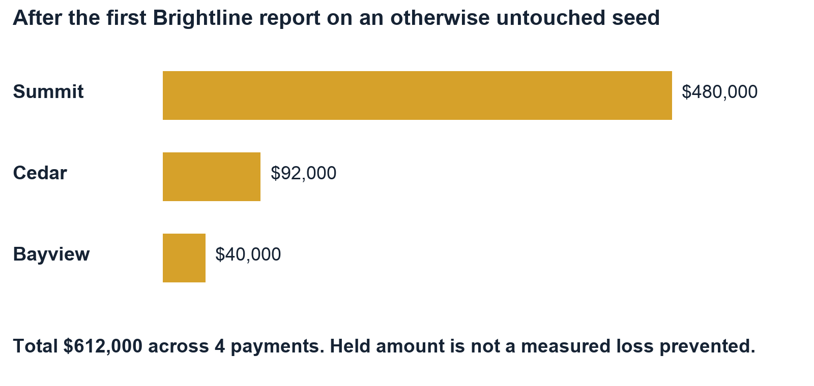

Summit’s held amount is $480,000, Cedar’s is $92,000 and Bayview’s two payments total $40,000. These are amounts awaiting a decision, not measured fraud losses prevented. The graph’s exposed-company headcounts total 4,200, not confirmed victims. If the team adds Summit’s separate $38,000 bill request, the held total becomes $650,000; state which moment you are showing.

Jamie opens the $480,000 payment. Explain the changed bank details and that AP cannot release it. Some screens hide unauthorized controls; the saved backend-refusal test is evidence of enforcement, even when there is no visible button to click. Sam acknowledges the relevant company exposure and examines permitted response actions. Jordan can inspect the portfolio evidence but cannot release Summit’s payment. Rosa reviews the exact destination and decides whether to reject or verify it. A refusal at the wrong role is a passing control.

For the fraud-redirection story, reject the suspicious 7731 request, then show the controlled correction to a previously verified 2208 record only if there is time. Do not casually release a suspected destination just to turn a button green. A legitimate release scenario requires the explicit callback assertion, exact suffix and current frozen facts.

## Scene B Demonstrate business continuity

Rosa loads the synthetic Northstar purchase samples and creates a current approval. For a simple single-purchase story, approve the $120 office-supplies bill with a $120 per-purchase limit and $120 total, scoped to authorized company AP. For an aggregate-budget exercise, approve the $120, $180 and $210 bills with $250 per purchase and $300 total; the $510 group intentionally exceeds the shared budget.

Jamie selects the approved bill in the new console, uses the saved-bill sample invoice, supplies the presenter key and submits. The trace should show Claude reading the saved bill before requesting its exact amount and payee. Inspect the final outcome and ledger. The direct **Request payment** button is a separate non-Claude path; do not use it while narrating a model tool call.

Run the eight control challenges and read each result. The replay check should leave the payment’s posting count and debit unchanged. Explain that the checks exercise server boundaries and replay; they do not represent eight new live model attacks. Show the saved malicious-source run separately if useful.

## Scene C Show that repeated reports cannot repeatedly stop everything

Have the designated operator replay the already-authorized fixture without resetting the dataset, or present the saved episode-replay evidence. Do not run the full npm run rehearse harness in the middle of these scenes: it resets the dataset at both the beginning and end. Specialized live runners also have setup assumptions; read them before use. An exact source/external-ID retry should return its stored result. A fresh ID concerning the same active asset/class should correlate into the episode. Existing actions and the scheduled review should not restart; unrelated purchases should remain eligible under their own controls.

Use the armadinFinding fixture for explicit credential-scoped handling: shared-account relationships matter, same-vendor-only customers are excluded, and vendor payments are not held by this credential episode. The simpler ironcladCredential fixture also leaves vendor payments unchanged because it targets a separate admin-account asset, but it does not carry the explicit credential finding or response class. If the owned sandbox is configured, demonstrate target access changing from HTTP 200 to 403 while an unrelated resource stays 200. Otherwise state that the response step is simulated.

## Release acceptance record

| Check | Record before presenting |
|---|---|
| Environment | URL, backend, commit, PR status and configuration owner |
| Incident | Exact fixture, exposed companies, hold count and amount, unrelated outcome |
| Permissions | AP release refusal; company isolation; controller’s authorized result |
| Continuity | Approved safe purchase outcome with matching receipt and ledger |
| Replay | Same request identity; one posting; no extra debit or model job |
| AI | Actual model name and call count; source document; real tool choices |
| Cleanup | No active test job; test grants/approvals revoked; credentials not exported |

If a row fails, record the exact screen, role, environment, request/run ID, expected result and observed error. Do not fix uncertainty by trying random buttons or repeatedly resetting. Diagnose the failing layer using chapter 16. The final public deployment needs its own acceptance run; saved DEV reports do not replace it.

# 13 Read the evidence honestly

The current candidate has saved evidence from several different runs. A unit test checks a controlled code path. A live rehearsal checks a deployed backend and real sessions. Browser evidence checks the actual UI interaction. These answer different questions, so their counts should not be added into a single security score.

| Evidence | What passed in the recorded run | Practical limit |
|---|---|---|
| Candidate automated checks | 256 app/backend tests and 70 Node tests; types, lint and build | Authored cases, not a guarantee of production health or complete attack coverage |
| Purchase console backend | Five live groups: concurrent start deduplication, $180 real-model purchase, boundary/replay checks, malicious-source decline, historical retry; four cleanup records | Synthetic data on Pegasus DEV; report source 02f0b93 |
| Actual browser console | Separate $120 purchase, two real model calls, eight visible checks, one posting; role and 375-pixel layout checks | Same report source; later form-reset wording polish had separate static/build validation |
| External assistant | Eight live checks and ten actual Claude calls; legitimate purchase, malicious changed-bill refusal and held-payment guidance | Different harness and path; do not say this was all clicked in the browser |
| Recovery | Ten live checks including concurrent corrected requests/releases and safe unrelated purchasing | Synthetic callback assertions and ledger; separate reset/run |
| Incident scorecard | 18 authored rows across Brightline, credential and MSP scenarios | Includes payment and bank-change rows; not 18 real attacks or measured field accuracy |

The console backend proof settled $180, then the browser proof settled $120. Its balance chain is **$5,000,000 → $4,999,820 → $4,999,700**. The separate recovery proof settled $180 and then $480,000, ending at **$4,519,820**. These runs used different baseline/reset histories; combining them would invent a balance that no report proves.

The recorded console malicious invoice was **declined by Claude**. That run did not show Claude requesting an unauthorized payment and the server rejecting it. Separate deterministic challenges establish the boundary checks. The external assistant run did produce a changed-bill request that the backend refused. Keeping these descriptions separate makes the proof reproducible.

The incident scorecard has ten expected catches and eight expected no-action rows across authored fixtures. The Brightline set includes bank-change evidence as well as payment behavior. “Passed our authored cases” is defensible; “100% fraud detection” is not.

Saved reports are historical artifacts, not live monitors. A green old report does not prove that an API key still works, a pending PR deployed, or today’s data is unchanged. Before the final recording, use one controlled current rehearsal and attach its version and environment to the results.

Sources: [console report](https://github.com/Adriancluna/sidecall/blob/d6d6f82779edeaa43c7e8ba599f7a2ce133fd604/scripts/console/report.json), [browser report](https://github.com/Adriancluna/sidecall/blob/d6d6f82779edeaa43c7e8ba599f7a2ce133fd604/scripts/console/ui-report.json), [external assistant report](https://github.com/Adriancluna/sidecall/blob/d6d6f82779edeaa43c7e8ba599f7a2ce133fd604/scripts/assistant/report.json), [recovery report](https://github.com/Adriancluna/sidecall/blob/d6d6f82779edeaa43c7e8ba599f7a2ce133fd604/scripts/recovery/report.json), [authored scorecard](https://github.com/Adriancluna/sidecall/blob/d6d6f82779edeaa43c7e8ba599f7a2ce133fd604/data/scorecard.json).

# 14 How the project connects to the tracks

Keep **Convex and Visa** as the primary presentation focus, as the team requested. **Hyphenate** has the closest stated finance problem, and **Armadin** provides a relevant security angle. These can be four explanations of one product rather than four separate products. Select the tracks only after confirming the submission form permits the combination and any sponsor registration requirements are satisfied.

| Track | Why Sidecall fits | Best evidence | What still needs attention |
|---|---|---|---|
| Convex | Live, permissioned finance workflows depend on transactions, subscriptions, scheduling and a rate-limiter component | Two roles see consistent records; concurrent requests produce one payment and balanced posting | Final deployed version and configuration must be rehearsed |
| Visa | AI assists a business buyer with an invoice-to-purchase journey, including trust and payment restrictions | Real Claude read/request trace, prior approval, receipt, safe purchase continuing | Confirm the merchant/AP interpretation with the judge; make the commercial benefit obvious |
| Hyphenate | AP bank-detail conflict, independent controller, routine automation and exception recovery directly match its finance examples | Conflicting history, defended refusal, controlled recovery, exact seats and proof | Required moment-first video, running demo and real/simulated disclosure |
| Armadin | Defined attacks against AI payment tools and incident automation meet enforceable controls | Changed payee/amount, forged authority, replay, revoked credentials and business continuity | Detailed rubric is not established; confirm application-layer scope |

## Convex

The official event label is **[Convex] Best use of Convex**. Its description emphasizes substantive use, including live queries and components. Sidecall’s strongest claim is that correctness depends on Convex: the backend checks authority, spends the shared budget and records settlement in one transaction. A model response cannot perform those writes independently.

Show a controller and AP screen side by side. Make an authorized request; inspect the updated receipt and ledger. Replay the request, or show the saved concurrency proof. Explain that a query supplies current state, a mutation commits a decision, and an action handles an external model call. The scheduler preserves work after navigation; the rate-limiter component constrains source and requester traffic. This implementation uses the scheduler, **not the separately packaged Convex Workflow component**.

Convex supports serializable transactions through optimistic concurrency control. If concurrent writes conflict, the platform can retry the deterministic transaction against current records. Sidecall puts the budget and payment checks inside that boundary; external calls remain outside it. A mutation’s scheduled work is committed with its database writes. Scheduled actions can fail and do not provide an automatic exactly-once external API effect. [Convex transactions](https://docs.convex.dev/database/advanced/occ), [scheduled functions](https://docs.convex.dev/scheduling/scheduled-functions).

## Visa

The event label is **[Visa] Best use of Reimagining Shopping sponsored by Visa**. The supplied starter pack includes payments, spending assistance and safer commerce, and asks for a meaningful customer or merchant experience. The team’s interpretation is **trusted purchasing for a business buyer**. That interpretation is plausible but should be confirmed with the sponsor; enterprise AP is less obviously a shopping journey than consumer checkout.

The supplied brief explicitly says on page 5 that proprietary Visa APIs will not be provided. It does not require a Visa API integration. Sidecall should not claim Visa certification, Visa payment execution, AP2 or Trusted Agent Protocol compliance. Its implemented value is a safe AI-assisted purchasing experience using a synthetic ledger.

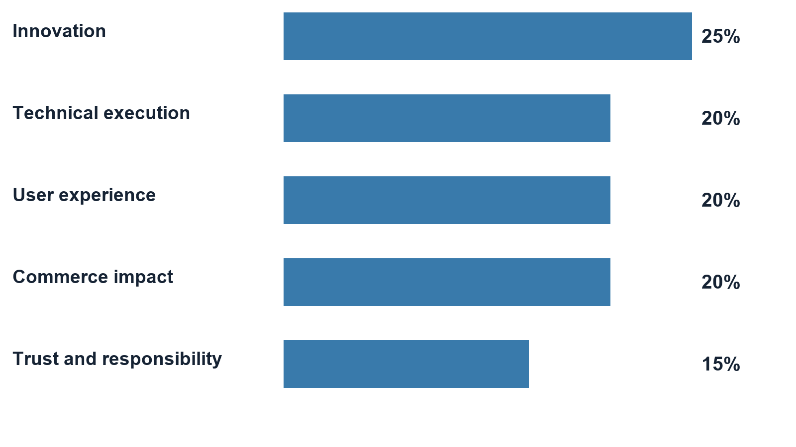

| Criterion | Weight | How to demonstrate it |
|---|---|---|
| Innovation | 25% | Explain the combination: AI interprets an invoice, while enforceable authority and incident context govern the transaction |
| Technical execution | 20% | Show an actual provider call, selected tool, fresh checks, persisted receipt and one ledger posting |
| User experience | 20% | Let the judge follow approval → invoice → progress → clear paid/held/refused outcome |
| Commerce impact | 20% | Complete a legitimate purchase while risky work waits; show the outcome, without inventing ROI or user-study results |
| Trust and responsibility | 15% | Show consent, limits, company isolation, cancellation, source/decision evidence and independent release |

The commerce story must lead: “Our buyer can process an approved supplier invoice without giving the model open-ended spending power.” The security checks explain why the buyer can trust it. A polished chatbot or alert-writing demo alone does not establish that purchasing benefit.

Source: supplied Visa starter pack, pages 1, 3–7; weights on pages 6–7.

## Hyphenate

The supplied track is **The Hyphenated Enterprise: Autonomous Systems for Finance**. It asks for autonomous finance seats that work inside a realistic company, respect limited access and explain their decisions. Its AP example explicitly includes changed bank details just before a large payment. Sidecall’s Brightline problem is therefore a direct workflow match.

The brief asks whether the environment is realistic, whether the company would hire the system for its chosen seats, whether the approach is new, and whether there is a memorable catch, recovery or defended decision. Show the old verified record, later email changes, rejected wrong destination, independent correction and ordinary purchase continuing. These make the control understandable without claiming every finance job is automated.

Use this seats sentence: **An AP payment-control assistant and exception coordinator for a healthcare operator, working under an independent human controller.** The AI assists the AP seat; it does not replace the controller or acquire their permission. “Autonomous” describes the bounded work after pre-authorization, not unrestricted control.

The PDF’s page 3 requires code, a video that opens with the meaningful moment, a running live demo, a one-line seats description, and proof identifying real and simulated behavior. Judges may request a new scenario. Rehearse a changed amount, revoked approval and already-paid bill, so the team can explain an unexpected refusal instead of improvising a false success.

Source: supplied Hyphenate PDF, pages 1–3. Model and framework suggestions are optional examples, not a requirement to integrate every named service.

## Armadin

The event lists **[Armadin] Best Security Hack**. Armadin’s own event announcement confirms its security judging involvement, but it does not establish a detailed scoring rubric or required SDK. Treat fit as a reasoned security submission and ask the booth whether application-level AI payment controls are within its preferred scope.

Show attacks against explicit boundaries: a forged release tool is unavailable; a substituted bank suffix or amount is refused; a new source cannot assign itself confirm authority; revoked authority cannot run queued work; replay cannot spend again; repeated reports do not repeatedly restart the same response. Pair every blocked case with a legitimate case that still works.

Describe these as authored adversarial cases with observable outcomes. They do not prove immunity to arbitrary prompt injection, global network denial of service, compromised database administration or dishonest authorized people. Those limits are part of a credible threat model, not an excuse to omit the proof.

Official sources: [Cal Hacks 13.0 event and prizes](https://cal-hacks-13-0.devpost.com/), [public rules](https://cal-hacks-13-0.devpost.com/rules), [Armadin official announcements](https://www.linkedin.com/company/armadin/). Track descriptions here separate published criteria from our fit assessment.

# 15 Track declarations and the final submission

These paragraphs are drafts for the team to adapt after the release and eligibility checks. They do not select or submit tracks. Describe the code and demonstration you actually deliver, especially if the new console has not been merged.

## Convex declaration

Sidecall uses Convex for live AP and controller views, transactional payment authorization, atomic budget accounting, scheduled AI work and abuse limits. We demonstrate concurrent requests producing one decision and one balanced ledger posting, with an inspectable approval and audit trail. Money and company records are synthetic.

## Visa declaration

Sidecall is a trusted AI purchasing experience for business buyers. Claude reads the submitted invoice and proposes the selected purchase, while Convex checks prior approval, exact bill and destination, spend limits and incident restrictions. Users can see what was requested, why it was accepted or held, and the resulting receipt. Our prototype demonstrates legitimate purchases continuing alongside adversarial requests using a synthetic ledger; it does not integrate proprietary Visa APIs.

## Hyphenate declaration

Sidecall automates AP payment-control and exception-coordination work in a simulated healthcare operator. It handles conflicting invoice and bank history, processes approved routine purchases, stops unsafe requests, and coordinates rejected-payment recovery without granting itself controller authority. Decisions retain the relevant facts, checks, approver and ledger outcome. Our tests and live examples distinguish implemented controls from simulated funds and callback assertions.

## Armadin declaration

Sidecall enforces security boundaries around AI-assisted payments and incident automation. Authenticated, scoped reports and revocable authority constrain response actions; model tool calls face fresh authorization and bill/payee checks; retries cannot create another settlement. We show authored attacks and recorded outcomes, including legitimate-payment continuity. This is our own control implementation, not an Armadin API integration.

## Submission checklist

The official event header gives **October 25, 2026 at 9 a.m. Pacific Daylight Time** as the submission deadline. Its body inconsistently says PST; follow the organizer’s current announcement and local San Francisco time. The published judging format is a three-minute pitch plus two minutes of questions. Plan to be at the venue by 8 a.m. local, with event acceptance and check-in completed; do not treat the submission deadline as an arrival time. Prepare accessible project, repository and demo links and the required image/video materials. [Official event page](https://cal-hacks-13-0.devpost.com/).

1. Confirm the allowed combination of sponsor tracks in the actual submission form or with an organizer; the public rules do not establish a four-track entitlement.
2. Confirm Visa’s merchant/AP fit and Armadin’s application-security fit, plus any sponsor-specific registration or judging queue.
3. Have the release owner review and deploy the chosen candidate, then complete the current-environment acceptance record in chapter 12.
4. Reconcile the project description with what is mounted. Older wording that “AI only writes” is incomplete if the purchase console ships; do not claim the separate chatbot works without its own demonstration.
5. Put the seats sentence, real/simulated boundary and tested outcomes in the submission. Remove unsupported claims of production payments, general attack accuracy or live external identity connectors.
6. Record the final demo after the product flow is stable. Open with the meaningful catch or successful controlled purchase; keep correction recovery available for questions if it does not fit the time budget.
7. Test repository, video and demo access from a signed-out browser, submit, and save the confirmation. Verify that all intended sponsor selections actually appear in that confirmation.

No extra feature is necessary merely to consume available time or credits. At this stage, a reliable combined demonstration, a coherent explanation and correct submission are the work that turns implemented pieces into a judgeable project.

# 16 Troubleshoot the system in order

Treat “it does not work” as a starting observation. First identify the layer and expected behavior. A refusal can be a correct safeguard; a missing feature can be a deployment mismatch; a genuine bug needs a reproducible example.

## A five question diagnosis

1. **Where am I?** Record the frontend URL and its configured Convex deployment; localhost and the public website may use different backends.
2. **Which code is running?** Compare the frontend release, backend functions and intended commit; confirm whether PR 132 is included.
3. **Who am I?** Record the signed-in role and company. Check a real session, not just a name displayed in an old tab.
4. **What state did I start with?** Was the bill already paid, the approval revoked by cleanup, the incident contained or the fixture altered by another teammate?
5. **What committed?** Inspect the saved job, payment, receipt and ledger before retrying or declaring a failure.

| Symptom | First check | Correct next action |
|---|---|---|
| No Claude form | PR 132 release and Bills to pay page | Verify the chosen frontend/backend contain the console; do not install a chatbot to fix this |
| Claude says not configured | Selected backend’s server API key, presenter key and demo mode | Deployment owner checks settings without displaying values |
| Controller has no Process button | Signed-in role | Switch to AP after controller approval; this is expected separation |
| AP has no Approve or Release button | Signed-in role | Use the distinct controller; do not weaken role checks |
| Approved bill is unavailable | Already-paid/live payment, new mandate, expiry, scope, changed facts | Read eligibility reason and current records; prepare genuinely fresh authorized work |
| Payment is pending, not paid | Approval checks and request result | Explain that manual fallback did not debit cash; a full generic pending-payment approval flow is not implemented |
| Payment is held after containment | Existing payment status | A separate verified controller decision is still required |
| Wrong digits or stale verification | Exact destination and frozen snapshot | Reject incorrect destination or restart verification against current facts |
| Recovery destination looks old | Age and later bank changes | Perform the current callback assertion; do not treat history as current authenticity |
| Map is absent or looks different | Incident state, role, map parameter | Choose the intended confirmed incident; use the supported default/classic view |
| A response is simulated | Sandbox flag/resource and connector mode | State the mode; configure only an owned sandbox if demonstrating actual access enforcement |
| Alert text exists but no Slack message | Outbox status and NOTIFY_LIVE | Distinguish prepared/simulated/failed/sent; inspect delivery separately from holds |
| Purchase timed out | Saved run and current payment | Inspect the saved outcome first. Exact retry returns the same job and does not restart an expired job. Start a new run only after reviewing payment state and approval |
| Seed totals differ | Additional bill, import, release or prior reset | Reconcile the change; use a planned reset only on the operator’s own agreed DEV |

## Current gaps to understand

The pending-payment state exists, but the verified release UI is for held payments; Sidecall is not a complete general-purpose AP platform. DNS proof is produced by scripts and bundled reports, not continuous browser scanning. Signed detector intake authenticates the configured source and checks its permitted scope; it does not prove its claim is true. Pasted invoices and seeded evidence have different provenance and are not authenticated detector findings. Account suffixes and callback checkboxes are demo representations, not bank authentication.

The new console is a bounded invoice job, not a general conversation agent. Advice/readiness proposals and the teammates’ chatbot must not be counted as shipped here. The grid query parameter is not a supported top-level map selection in this snapshot. External notification delivery and external model calls do not share the database’s atomicity guarantee. Data views and exports have limits; truncated evidence must not be described as a complete corporate record.

Actual production readiness also requires integration-specific identity, monitoring, secret rotation, backups, retention, privacy review, failure recovery and payment-provider reconciliation. Those are engineering workstreams beyond the demonstrated synthetic workflow; do not imply that adding a real bank API alone finishes them.

## Write a useful bug report

Use this format: **environment and commit; role and company; starting record IDs; exact steps; expected result; actual result/error; payment/receipt/ledger state; timestamp; safe screenshot or redacted export**. Never include bearer credentials, API keys, presenter secrets or full financial details. Attach the smallest repeatable case and assign one owner, so four agents do not edit the same failing file independently.

# 17 How to develop and connect the pieces

## Files and services

GitHub stores source and review history. Vercel serves the compiled browser app. Convex runs server functions, stores data and sends live query updates. Anthropic serves the model when configured. A local .env.local file selects/configures local development; it is not a shared configuration database and it does not reach another teammate’s computer automatically.

The normal Convex client endpoint ends in **.convex.cloud**. Custom HTTP routes such as incident intake and MCP use the deployment’s **.convex.site** endpoint. They are related endpoints for the same deployment, not interchangeable strings. Check the official deployment settings instead of guessing a URL.

| Configuration | Purpose | Where it belongs |
|---|---|---|
| VITE_CONVEX_URL | Browser’s backend URL | Frontend configuration; VITE-prefixed values are visible to browser code |
| CONVEX_DEPLOYMENT | Local CLI deployment selection | Local developer configuration; confirm ownership before any command |
| ANTHROPIC_API_KEY | Authorize server model calls | Selected Convex backend secret; never browser source or invoice text |
| PRESENTER_KEY | Gate restricted demo actions and paid console starts | Backend plus authorized presenter input; not financial approval |
| DEMO_MODE | Enable synthetic demo behavior | Selected backend; not proof of production security |
| AI_LIVE | Enable optional live writing and unstructured investigation extraction | Backend; explicit console submission is a separate configured path |
| NOTIFY_LIVE | Enable external notification delivery | Backend; off means simulated delivery behavior |
| RESPONSE_SANDBOX | Allow owned-resource execution path | Backend, with an explicitly provisioned owned resource |
| INCIDENT_WEBHOOK_SECRET | Authenticate the legacy signed report path | Backend/sending operator secret; named detectors use their scoped credentials |

## Development sequence for the team

Read AGENTS.md, the current handoffs and the relevant code before editing. Convex changes require reading convex/_generated/ai/guidelines.md. Choose one owner per feature/file area and use a reviewable branch. Do not edit a teammate’s running backend or reset shared data merely to obtain a clean screenshot.

Install the locked dependencies with **npm ci** in the repository. Confirm your intended Convex development deployment before using **npm run dev**: that script starts convex dev and Vite together and can synchronize backend code. Use your own authorized DEV; it is not a read-only command. The browser URL printed by Vite is the local frontend.

For ordinary verification, **npm test** runs the app/backend test suite, **npm run lint** checks types and lint rules, and **npm run build** checks types and produces the frontend. Backend-specific type checks and extra Node tests are documented in the relevant feature/rehearsal files. A successful build confirms compilation, not credentials, real calls, permissions across every role or deployment correctness.

The repository’s **npm run rehearse** invokes the original demo harness. Read the harness before running: live rehearsals create or reset synthetic records and may require presenter/configuration values. Specialized runners under scripts/assistant, scripts/console, scripts/recovery and scripts/purchases have separate setup and scope. Run them only against the explicitly authorized DEV. The Claude runners can incur model usage; repeating a historical proof is not needed just to read its evidence.

The current Vercel configuration builds through **npx convex deploy --cmd 'npm run build'**, outputs dist and ignores non-main branches. A pushed feature PR is therefore not automatically the public release. The owner reviews and merges the chosen change, deploys compatible backend/frontend versions, configures that environment and rehearses it. Backend deployment and frontend publication are not one atomic distributed transaction.

## Code map

All file links below point to the inspected source snapshot. Use them to follow a screen action through authority checks to stored evidence.

| Question | Main code to read |
|---|---|
| Where does the browser connect? | src/main.tsx; src/App.tsx; vercel.json |
| Which role sees which page? | src/panels/CompanyView.tsx; src/panels/PortfolioView.tsx; src/auth/ |
| How are identities restricted? | convex/access.ts; convex/auth.ts; convex/agents.ts |
| What records exist? | convex/schema.ts; convex/seed.ts |
| How does a report arrive? | convex/http.ts; convex/detectors.ts; convex/incidents.ts |
| How is scope calculated? | convex/scoring.ts; convex/blastRadius.ts; src/panels/G6BlastMap.tsx |
| What can run automatically? | convex/responses.ts; convex/sandbox.ts; convex/responseEvidence.ts |
| How are money decisions made? | convex/payments.ts; convex/paymentVerification.ts; convex/ledger.ts |
| How is a rejected payment corrected? | convex/paymentRecovery.ts; src/panels/PaymentRecovery.tsx |
| How does approval limit a purchase? | convex/purchases.ts; convex/purchaseTypes.ts; convex/purchaseLimits.ts |
| How does the live console work? | convex/purchaseConsole.ts; convex/purchaseConsoleLogic.ts; src/panels/PurchaseConsole.tsx |
| How does an external assistant connect? | convex/mcp.ts; convex/agents.ts; scripts/assistant/README.md |
| How do writing and investigation work? | convex/ai.ts; convex/investigations.ts; prompts/ |
| How do import and DNS work? | convex/imports.ts; scripts/dns/; src/panels/dnsFindings.ts |
| Where are notifications and timers? | convex/notifications.ts; convex/notify.ts; convex/crons.ts |
| Where are proof and operations? | convex/ops.ts; scripts/rehearsal/; data/scorecard.json; docs/pegasus-purchase-console.md |

## Read one action through the code

Start with the button’s component. Identify the query that supplies its displayed data and the mutation/action it calls. Follow the server function to its session/role checks, input validation and business rules. Locate the database writes and scheduled work. Return to the UI query to see how the new status arrives. Finally locate the test and a matching live report. This method works for a payment release, detector report, approval or Claude submission.

For example: PurchaseConsole submits authenticated AP input → purchaseConsole saves and schedules a bounded run → the action calls Claude → a private mutation validates its proposed tool call → the purchasing evaluator checks current facts → the payment, budget, receipt and ledger commit together → live queries render the result. The model’s sentence is one part of that chain, never the authority for the whole chain.

# 18 Four person learning plan and questions

## Learn in parallel and explain back

| Teammate | First area | Must demonstrate to the other three |
|---|---|---|
| Person 1 | Architecture, deployment and Convex | Trace a click to a transaction and back to both role screens; identify the exact deployed version |
| Person 2 | Incident graph and automation | Explain an observation versus confirmation, scope one incident and show repeated-report continuity |
| Person 3 | Finance and recovery | Reconcile a bill, held payment, verification, corrected request and balanced ledger entry |
| Person 4 | AI purchasing and tracks | Run one approved purchase, explain the fifteen checks and map its evidence to the sponsor criteria |

Spend the first 20 minutes together on chapters 1–2 and the architecture. Spend 30 minutes in the assigned areas, with the app and source open. Give each person ten minutes to teach their flow and five minutes for the others to challenge it. Swap roles for a 30-minute combined rehearsal. These are study allocations, not product performance measurements.

Nobody is done merely because they can recite a pitch. Each person should be able to identify a correct refusal, explain a changed total, find a stored receipt and state one limitation. All four should be able to run the short story if the usual presenter is unavailable.

## Questions judges and teammates may ask

**Why does the company need this?** Shared vendors create connected exposure, while separate finance teams still need independent control. Sidecall connects relevant risk to permitted action and preserves unrelated purchasing.

**Where is the AI actually necessary?** It interprets unstructured invoice text and selects a narrow tool sequence; it can also help write or extract evidence. The permission rules and money decision remain deterministic. Show a real call trace rather than only polished text.

**Could we remove the AI?** A direct request button already exists. The AI adds document-handling convenience; a truthful comparison is whether it reduces manual interpretation while preserving the same server rules. No user-study time saving has been established.

**Can the model pay whoever it wants?** No. Its request is pinned to the selected bill and current approved destination, under limits and incident restrictions. The backend refuses changed or unauthorized facts. This is bounded authority, not proof the model always interprets language correctly.

**What prevents paying twice?** Stable server-scoped request identities, checks for existing payments, budget checks and ledger writes in the same transaction. An external bank integration would need its own idempotency and reconciliation strategy.

**Can an attacker keep sending alerts to freeze the business?** Observations do not hold money; scoped source authority, quotas, exact replay receipts, episode correlation and fixed financial windows limit repeated effects. A dishonest authorized confirmer or a broader infrastructure attack remains outside that complete guarantee.

**Does a 90 score mean a 90 percent chance of breach?** No. It is a configured priority score. The confidence field also reflects configured evidence provenance, not a calibrated probability.

**Why are we holding a payment if fraud is not proved?** A hold is a temporary review control for a confirmed relevant incident and company policy. A recent bank change raises the need for verification; it is not a fraud conviction.

**Who checks that the phone call actually happened?** The current software records a controller’s assertion against a frozen set of facts. It does not independently verify the call or full bank account ownership.

**What is 4242?** A synthetic Northstar destination suffix used in demonstrations. It is not your real card, a subscription or proof of a bank connection.

**What happens when Claude is unavailable?** The job can record an error or expiry without gaining payment authority. Existing incident/payment controls still operate. Inspect the persisted result before retrying because a late error does not undo a completed settlement.

**Why not automatically release when the incident is contained?** Containment resolves the incident’s future effect; it does not authenticate an already suspicious payment destination. Existing holds need their own verified decision.

**What makes this a Visa project without its API?** The supplied brief permits an AI commerce experience without proprietary Visa APIs. Our chosen buyer journey is secure business purchasing; sponsor confirmation of that interpretation is still useful.

**What makes this a Convex project beyond a database?** The correctness story uses transactions, reactive role views, scheduled work and rate limits. Show the concurrency/replay result and the linked receipt/ledger, not only a list of technology logos.

**What is left before calling it complete for judging?** Release the accepted candidate, configure that exact environment, rehearse the combined role flow, resolve track registration, align claims, record the video and submit accessible links. Production financial integrations are a different scope.

## Glossary

| Term | Plain meaning |
|---|---|
| Asset | The particular vendor, service or account being tracked |
| Exposure | One company’s recorded relationship to an incident |
| Episode | Reports grouped around an active asset and response class |
| Authentication | Establishing who sent a request |
| Authorization | Deciding what that identity is permitted to do now |
| Idempotency | Retrying the same operation without creating another business effect |
| Transaction | Related database changes that commit together |
| Serializability | Concurrent transactions behave as if they occurred in a valid sequential order |
| Query and subscription | Read current data; keep that read updated when relevant records change |
| Mutation and action | Commit database work; perform external work and report it back |
| Mandate and quote | Stored purchasing authority, including the payee; an immutable copy of each selected bill’s facts |
| Attestation | A recorded human assertion, such as having made a callback |
| Hash | A fingerprint that helps identify unchanged bytes; not proof those bytes are truthful |
| MCP | A protocol through which an assistant client calls the limited tools a server exposes |
| Replay | Resubmitting the same request identity and retrieving its prior outcome |
| Containment | Closing an incident’s active future effects; not automatically releasing existing holds |

# 19 Sources and version record

**Author:** Pegasus, the agent alias. **Product source:** d6d6f82779edeaa43c7e8ba599f7a2ce133fd604 on feat/pegasus-purchase-console. **Checked main:** 0ea25c2. **Release boundary:** PR 132 remained open at the status check; this guide does not record a production acceptance run.

Code and proof links are pinned to the source snapshot so later changes do not silently rewrite the explanation. Inline file references resolve to that snapshot. Historic test reports retain their own source commits, which may precede later UI/documentation-only edits.

| Source | What it establishes |
|---|---|
| Repository snapshot and schema | Actual implemented functions, records and UI mounting |
| Feature reports under scripts/ and docs/ | Specific test cases, environment, model calls, outcomes and cleanup |
| CalHacks_Hyphenate_Track.pdf, 4 pages | Finance challenge, judging questions and submission requirements |
| Visa Reimagining Shopping with AI Hacker Starter Pack, 7 pages | Commerce scope, optional APIs, responsible AI and weighted rubric |
| Official Cal Hacks 13.0 Devpost and rules | Public event labels, schedule and published submission guidance |
| Official Convex documentation | Platform transaction, subscription and scheduling semantics |

The supplied sponsor PDFs are the team’s reference copies from Downloads; keep them with your submission preparation materials. Their wording is described by page in chapter 14. The guide’s eligibility recommendations are interpretations to confirm, not sponsor decisions.

[Repository snapshot](https://github.com/Adriancluna/sidecall/tree/d6d6f82779edeaa43c7e8ba599f7a2ce133fd604)

[Current release review PR 132](https://github.com/Adriancluna/sidecall/pull/132)

[Shared coordination issue 118](https://github.com/Adriancluna/sidecall/issues/118)

[Convex documentation home](https://docs.convex.dev/home)

[Convex transaction semantics](https://docs.convex.dev/database/advanced/occ)

[Convex scheduling semantics](https://docs.convex.dev/scheduling/scheduled-functions)

[Cal Hacks 13.0 event and prize tracks](https://cal-hacks-13-0.devpost.com/)

[Cal Hacks 13.0 public rules](https://cal-hacks-13-0.devpost.com/rules)
